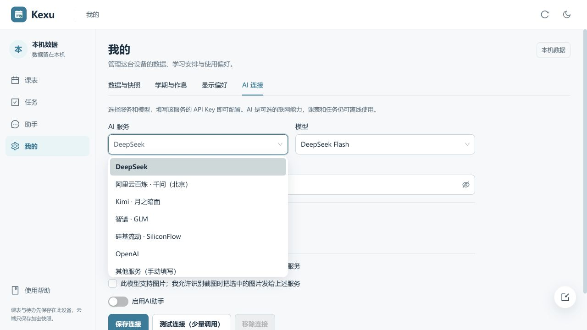
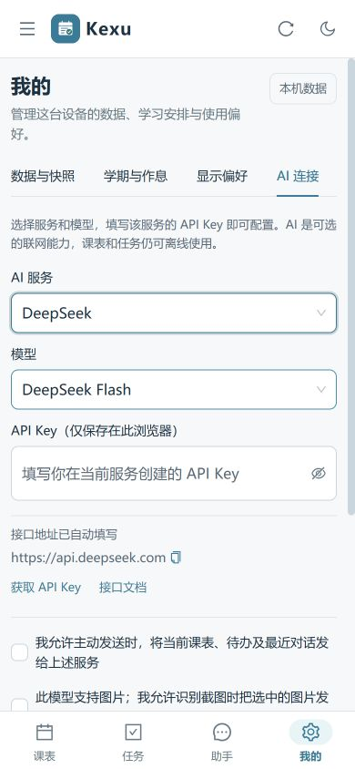

# AI 服务与模型预设

当前本地版在「我的 → AI 连接」中提供服务和模型下拉选择，常用服务自动填入地址。选「其他服务」才显示地址输入，选「其他模型」才显示模型名输入。用户仍需填写自己在所选平台申请的 API Key，确认上下文发送范围、启用 AI 并保存。

## 官方资料核对

以下接口与模型名于 2026-10-30 根据官方文档核对。预设是静态配置，不会在选择时请求服务，也不表示账号一定有模型权限、可用额度或浏览器跨域访问权限。

| 服务 | 自动填入地址 | 模型选项 | 官方依据 |
|---|---|---|---|
| DeepSeek | `https://api.deepseek.com` | `deepseek-flash`、`deepseek-v4-pro` | [首次调用 API](https://api-docs.deepseek.com/zh-cn/) |
| 阿里云百炼 · 千问（北京） | `https://dashscope.aliyuncs.com/compatible-mode/v1` | `qwen-plus`、`qwen3.8-max` | [OpenAI 兼容接口](https://help.aliyun.com/zh/model-studio/compatibility-of-openai-with-dashscope) |
| Kimi | `https://api.moonshot.cn/v1` | `kimi-k3.1-pro`、`kimi-k3.1-pro-highspeed` | [快速开始](https://platform.kimi.com/docs/get-api-key)、[模型列表](https://platform.kimi.com/docs/models) |
| 智谱 · GLM | `https://open.bigmodel.cn/api/paas/v4` | `glm-5.3-flash`、`glm-5.3` | [API 端点](https://docs.bigmodel.cn/cn/api/introduction)、[模型概览](https://docs.bigmodel.cn/cn/guide/start/model-overview) |
| 硅基流动 | `https://api.siliconflow.cn/v1` | `deepseek-ai/DeepSeek-V4-Flash` | [Chat Completions](https://docs.siliconflow.cn/docs/api/chat-completions-post) |
| OpenAI | `https://api.openai.com/v1` | `gpt-5.4-mini`、`gpt-5.4` | [GPT-5.4 mini](https://developers.openai.com/api/docs/models/gpt-5.4-mini)、[GPT-5.4](https://developers.openai.com/api/docs/models/gpt-5.4) |

百炼预设使用仍受支持的北京公共域名，Key 必须属于相应地域；其他地域、业务空间专属域名使用「其他服务」。智谱预设为标准 API，Coding 套餐的独立接口使用「其他服务」。列表不覆盖所有平台或模型，不支持的原生协议不能仅靠更换地址接入。

## 配置与隐私行为

- 没有保存连接的新用户默认看到 DeepSeek Flash 的地址和模型，启用与授权默认关闭。
- 根据原地址识别已有服务。未知地址和旧模型名保留原值，显示为「其他」，不自动迁移或替换。
- 同一规范化请求地址可以留空保留已保存 Key；服务、端口或路径改变时不会复用原 Key。手动地址改变目的地时，输入中的 Key 与授权同时清空。
- 选择服务会清除本次输入 Key 和两项授权；换模型关闭图片授权。图片能力与发送许可均不自动开启。
- 仅在点击测试时发送固定测试文字，不携带课表。测试期间禁止更改表单，组件卸载会取消请求，晚到的结果不会显示到新配置。
- Key 继续使用原私有设置存储，不进入核心数据或云快照。页面提供所选服务的官方 Key 获取入口。
- 设置页关闭悬浮快速导入入口，避免遮挡手机上的配置表单。

## 验证

- 新增 8 项预设与凭据隔离测试；与现有 AI 套件一起共 44 项通过。新增测试已接入 `test:local-ai`、`test:local` 和 CI。
- 类型检查、ESLint、生产构建通过；ESLint 仍有 6 条已有警告，Ant Design 共享分包仍有体积提示。
- 使用隔离的本机预览和无效演示 Key 验证：预设下拉、同服务换模型保留 Key、换服务后缺 Key 错误、授权重置、其他模型/服务保存及刷新、移除后恢复默认未启用状态。
- 检查桌面、390px、320px 与暗色模式。320px 文档宽度为 320px；Key 输入字号为 16px，长地址正常换行。
- 没有向真实 AI 服务发请求，没有使用用户真实 Key；不能据此宣称所有平台在当前网络可直连。真实连接仍由用户点击「测试连接」确认。

