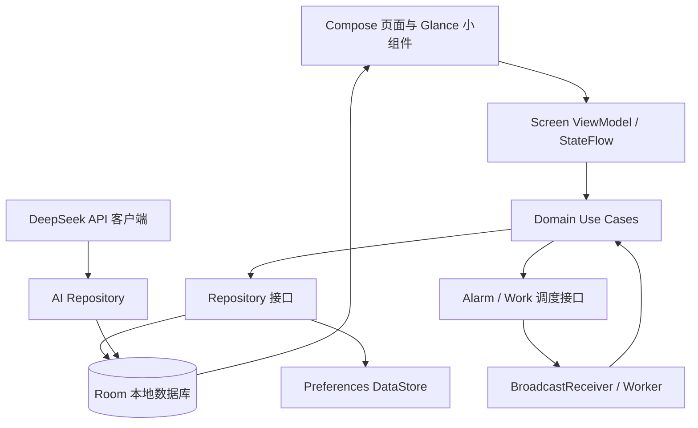

# Android 移动端实施架构方案

> 状态：实施基线；Android 首个离线业务切片已有源码，尚未在 Android SDK 环境完成构建。已落地与未落地范围见[实施状态](ANDROID_IMPLEMENTATION_STATUS.md)。
> 基线：独立项目空间内桌面版 `8f4f686`；Web/后端现状以[项目理解](../reviews/PROJECT_UNDERSTANDING.md)、[当前问题清单](../reviews/CURRENT_ISSUES.md)及 `src/` 当前代码为准。
> 日期：2026-09-27。本文细化并取代归档版[安卓离线单机版方案](../archive/handoff-2026-09-26/05-安卓离线单机版方案.md)；归档原文保留作历史记录。

## 1. 目标、范围与总决策

首版是一个 Kotlin 原生 Android 应用：课程表、考试、待办、循环规则及其提醒以手机本地数据为准，断网时仍可查看和编辑；DeepSeek AI 在联网且用户配置密钥时可用。这符合 Android 对离线优先应用“本地数据源作为读取真源”的建议（[官方离线优先指南](https://developer.android.com/topic/architecture/data-layer/offline-first)）。首版支持手动备份、恢复和业务数据交换；不做账号登录、远端数据库或设备间同步，同步留作后续独立阶段。

核心选择如下：

| 决策 | 首版方案 |
|---|---|
| UI 与导航 | 单 Activity，Jetpack Compose，按手机/平板宽度自适应 |
| 数据真源 | Room / SQLite；界面只订阅本地数据库数据流 |
| 业务层 | Kotlin use case 与 repository；课程、考试、待办的读写不经过网络 |
| 偏好设置 | Preferences DataStore；API 密钥另行使用 Android Keystore 加密 |
| 后台业务 | 最近提醒使用一个 AlarmManager 单次闹钟；循环触发/考试结束收敛使用另一个不精确单次闹钟；WorkManager 负责持久化补扫/重建 |
| 周期规则 | 结构化规则（每日/每周/每月及常见预设）；首版不执行用户 JavaScript |
| AI | 用户自带 DeepSeek API Key，网络直连模型 API；AI 只能生成本地提案，逐条确认后才提交 |
| 备份交换 | SAF 系统文件选择器 + 版本化 JSON；应用内全量恢复与合并预览 |
| 桌面小组件 | Jetpack Glance，离线只读展示，数据变更时主动刷新 |
| 后续同步准备 | 数据实体使用跨设备稳定 UUID 和版本时间戳；不提前实现同步队列或冲突合并 |

不要把 Spring Boot 服务、Tomcat、MyBatis、MySQL/H2 或桌面 WebView 运行时嵌入 APK。安卓端是新的本地应用边界，复用产品语义和经测试的纯计算规则，Kotlin 重写持久化、业务用例、UI 与平台集成。可在实施后评估把无框架的日期/规则算法抽成共享模块；首期不为代码复用引入跨平台构建复杂度。

## 2. 现有功能的承接与首版边界

当前产品的数据归属和关键规则见[项目理解](../reviews/PROJECT_UNDERSTANDING.md)：

- 一个用户可有多张课表；课程和考试属于一张课表，待办和循环规则属于用户全局；AI 会话可选择性绑定课表。
- 一条课程记录代表“星期 + 节次 + 教学周集合”，而非单次日历事件。教学周第一周锚定在学期开始日期所在自然周的周一；例如学期周三开始，则该周周一至周二虽早于学期起始日，仍用于计算“教学第一周”。移动端沿用此算法。
- 考试不关联某条课程记录。新建考试会生成关联待办，考试结束后该待办自动完成。
- 循环任务触发时生成独立待办；月中不存在指定日期时取月末。停机补扫单规则最多补 5 期，超出部分跳过，避免突然生成大量待办。
- AI 当前采用多条提案、逐条确认；必须保留“建议文本不会直接改数据”的边界。

首版不执行现有 `CUSTOM` JavaScript 规则。原规则每分钟在服务端运行任意脚本，这与手机后台调度和权限模型不匹配，也扩大了沙箱与电量风险。安卓创建页提供每日、每周、每月、工作日、隔周等结构化模板；月末规则可用“每月 31 日并取月末”表达。导入包含旧 `CUSTOM` 规则时，在循环规则记录中保留只读的 `legacyScript`，标记为“不支持、暂停”，绝不自动执行或静默丢弃；用户可手动重建为受支持模板。是否增加脚本能力待有独立隔离运行方案后再评审。

在手机窄屏上不强求展示桌面端 7 列完整网格：默认采用“周选择器 + 单日纵向节次列表”，课程卡覆盖连续节次；宽屏/横屏再显示整周网格。任何节次/周次冲突都要明确标示，不静默覆盖或隐藏课程。

## 3. 整体架构和依赖方向



方向约束：UI 不直接访问 DAO 或 HTTP；ViewModel 把用户动作交给用例并暴露 `StateFlow<ScreenUiState>`；Repository 的业务读取只读 Room；网络只存在于 AI 数据源；Alarm Receiver 与 Worker 调用短小、可重入的用例，不复刻业务规则。Room 事务是跨表写操作边界。将 ViewModel 与 Composable 生命周期状态分开，Compose 用生命周期感知方式收集 Flow，遵循 Android 推荐的单向数据流与生命周期感知收集方式（[架构建议](https://developer.android.com/topic/architecture/recommendations)）。

### 3.1 工程与包结构

新工程放在 `src/android/`，使用独立的 Gradle Kotlin DSL 构建入口；首期一个 `:app` 模块，按功能和层次划分包，等边界稳定且模块确有独立编译/测试收益后再拆模块。

```text
src/android/
├── settings.gradle.kts
├── build.gradle.kts
├── gradle/libs.versions.toml
├── app/
│   ├── build.gradle.kts
│   └── src/main/
│       ├── AndroidManifest.xml
│       └── java/com/tangent/timetable/
│           ├── app/                 # Application、导航、依赖注入入口
│           ├── core/model/          # 领域类型、枚举、校验结果
│           ├── core/database/       # Room Database、Entity、DAO、迁移
│           ├── core/preferences/    # DataStore、密钥密文存取
│           ├── core/time/           # 学期周次、循环日期、时区换算
│           ├── core/reminder/       # AlarmManager、渠道、接收器、Worker
│           ├── core/backup/         # SAF、JSON DTO、验证、恢复事务
│           ├── data/                # Repository 实现、DeepSeek 数据源
│           ├── domain/              # 用例、业务校验、调度协调
│           ├── feature/timetable/   # 课表、学期、课程编辑
│           ├── feature/exams/
│           ├── feature/todos/
│           ├── feature/recurring/
│           ├── feature/ai/
│           ├── feature/settings/
│           ├── designsystem/        # 主题、通用组件、可访问性
│           └── widget/              # Glance Widget 与配置入口
└── schemas/                         # Room 版本化 schema JSON，纳入 Git
```

推荐 Kotlin、Jetpack Compose、Navigation（优先采用项目启动时稳定的官方导航组件）、Coroutines/Flow、Room、DataStore、Hilt、OkHttp（SSE）、WorkManager 与 Glance。使用 Gradle Version Catalog 锁定依赖版本；实施启动时核实 Android Gradle Plugin、Compose、Room 和 Glance 的兼容稳定版本，不在本设计文档锁死可能过期的版本号。建议 `minSdk 26` 作为首个提案，发布时将 `targetSdk` 设为当时平台与分发要求；`applicationId` 暂定 `com.tangent.timetable.android`，首个对外发布前冻结。统一以 Java 17 工具链构建，桌面端当前技术栈不随此变更。

工程首期已固定 AGP 8.13.2、Gradle 8.13、Kotlin 2.3.20、Room 2.8.5、Compose BOM 2026.09.00 与 Navigation 2.9.8，最低 API 26、目标 API 36。首期采用手动依赖装配，等边界稳定再评估 Hilt；依赖变更仍需对照官方兼容要求并实际构建验证。

## 4. 页面、状态和主要交互

底部主导航建议为“课表 / 待办 / 考试 / AI”，设置从课表切换器或更多菜单进入。新用户首次启动先创建学期课表，提供跳过 AI 配置的离线路径。所有 CRUD 在 Room 本地立即完成；联网状态只影响 AI。

| 页面 | 首版行为 |
|---|---|
| 课表 | 学期/周选择、今日或选中日纵向课程列表、课程冲突标记；平板提供 7 日网格 |
| 课程编辑 | 星期、起止节次、周次多选、教师、地点、颜色/备注；保存前校验节次边界、周次范围及冲突 |
| 考试 | 按日期时间排序，独立于课程；详情设置考试前提醒；删除考试时在同一事务中删除考试生成的待办和提醒 |
| 待办 | 全局列表、逾期/即将到期/已完成分组；支持完成、改期、提醒、来源跳转 |
| 循环规则 | 结构化频率编辑、预览未来三期、启停/归档；说明触发生成受系统后台时机影响 |
| AI | 流式对话、网络状态、取消、提案卡片逐条确认/拒绝；离线时可保留输入草稿但禁用发送 |
| 设置 | 作息时间、时区、通知/精确提醒状态、AI Key、备份/恢复/导入导出、数据清理说明 |
| 桌面小组件 | 当前周/选定日课程和最近待办；点击项目跳转应用；不承诺分钟级刷新 |

UI 状态推荐以 `Loading / Content / Empty / RecoverableError` 表示；本地数据已到达时，AI 网络错误显示在 AI 区域，不能阻塞课程页。大屏使用自适应导航；动态字号和 TalkBack 描述要纳入 UI 验收。

## 5. 领域规则和时间语义

### 5.1 教学周与课程冲突

存 `termStartDate`、`termEndDate`；`weekOneMonday = termStartDate.with(previousOrSame(MONDAY))`；日期对应的教学周为 `floor(daysBetween(weekOneMonday, date)/7)+1`。周次判断、周选择器、AI 课程提案和导入校验共用同一 `TermWeekCalculator`，禁止各自复制算法。课程的 `dayOfWeek` 使用 ISO 1–7（周一至周日），`weeks` 保存去重、升序且均在学期有效周范围内的整数数组。

冲突检测必须在 Room 写事务内再次执行：同一课表、同星期、节次区间相交、教学周集合相交才算时间冲突。AI 建课也调用同一验证服务。允许用户在明确看到冲突后仍保存的产品行为需由 UI 明确二次确认；不得把“卡片确认”隐式解释成忽略冲突。

### 5.2 本地日期、时区和循环实例

学期、课程节次、考试及待办截止时间分别保存 `LocalDate`、`LocalTime` 或 `LocalDateTime` 语义，数据库采用 ISO 文本；只有投递给系统 AlarmManager 时才转换成 `Instant/epochMillis`。课表保存 IANA `ZoneId`，默认取建立时设备时区；考试沿用该课表时区。全局待办/循环规则保存自己的时区策略（固定时区或跟随设备本地时区），不得只存 epoch 后让时区变化悄悄改写墙上时间。DST 导致墙上时间不存在时顺延到该时区的下一个有效时刻；墙上时间重复时选择较早 offset，每次只生成一个循环实例。设备时间/时区变化后重算未触发闹钟。

循环规则字段：标题、`DAILY/WEEKLY/MONTHLY` 或有限预设、星期/每月日期、触发 `LocalTime`、DDL 偏移分钟、时区策略、启用/归档状态、是否“完成当期后生成下一期”。`WEEKDAYS` 只在周一至周五触发；`EVERY_N_WEEKS` 必须保存 `anchorDate`、`intervalWeeks >= 2` 和 ISO 星期号，先取 anchorDate 所在周的周一，候选日相对该周的教学周序号模 intervalWeeks 为 0 且不早于 anchorDate 时才触发；不可用 ISO 年周数奇偶替代学期/规则锚点。下一期计算必须为纯 Kotlin 函数并有跨月、闰年、同一时刻边界测试。发生月末时，目标日取当月最后一天。每次具体期次按 `(rulePublicId, occurrenceLocalDateTime + zoneId)` 建唯一键；用户改截止时间不改变期次身份。生成待办与期次占位在同一 Room 事务中，重放、并发接收或补扫不能生成重复记录。若 `chainAfterComplete=true`，完成当前期时以规则已保存的 `nextTriggerAt` 立即物化下一期；随后到时的调度器按同一 occurrenceKey 命中已有实例并只推进规则，不重复生成待办。

考试自动完成不依赖每分钟数据库扫描：打开应用时执行一次到期收敛；可用不要求准点的单次后台任务在考试结束后尽快收敛。课程/考试/待办当前是否到期由已保存的墙上时间及时区计算，过期时用户打开应用必须立即看到正确状态。

## 6. Room 数据模型

所有可导出业务实体使用 `localId: Long` 作为本地 Room 主键，另有唯一、不可变的 `publicId: UUID String` 供备份和未来跨设备识别。可编辑实体含 `revision` 与 `updatedAt`；每个用户操作通过 Repository 更新数据与 revision。绝不把服务器现有自增数字 ID 当成跨设备身份。日期时间由 TypeConverter 或显式 ISO 文本字段持久化。外键、索引、唯一约束和删除策略必须写进 Room schema，并导出 schema JSON；正式版本不得使用 destructive migration（[Room 迁移指南](https://developer.android.com/training/data-storage/room/migrating-db-versions)）。

| 表 | 关键字段及约束 |
|---|---|
| `ScheduleEntity` | publicId、名称、学期起止日、时区、默认标记、revision；publicId 唯一；一张课表拥有多门课程和考试 |
| `DatasetMetadataEntity` | 单例数据集 publicId/sourceDatasetId、创建时间；恢复/合并不覆盖本机身份，文件保留来源身份 |
| `PeriodConfigEntity` | 节次号、起止 LocalTime、标签；首装种入当前默认作息，唯一节次号。沿用现状先全局共享 |
| `CourseEntity` | scheduleId、星期、起止节次、weeks JSON、名称/教师/地点/颜色；课表删除级联；索引 scheduleId + dayOfWeek |
| `ExamEntity` | scheduleId、标题、开始/结束墙上时间、地点、时区；课表删除级联；索引 scheduleId + startAt |
| `TodoEntity` | 标题、DDL LocalDateTime/ZoneId、完成状态/时间、可空 examId；考试生成待办的外键删除策略为随考试级联，普通待办为全局数据；索引 completed + dueAt、examId |
| `RecurringRuleEntity` | 频率（DAILY/WEEKLY/MONTHLY/WEEKDAYS/EVERY_N_WEEKS/LEGACY_CUSTOM）、星期/日期、间隔周数与锚点、触发时间/DDL 偏移、时区策略、下次触发、启用、chainAfterComplete、最近跳过区间摘要、revision、归档时间；仅 LEGACY_CUSTOM 可有只读 legacyScript 且永不执行；索引 enabled + nextTriggerAt；删除采用归档 |
| `RecurringOccurrenceEntity` | ruleId、唯一 (ruleId + occurrenceKey)、计划触发/DDL、状态、可空 todoId；支持已生成/跳过/失败记录与去重 |
| `TodoReminderEntity` | todoId、相对截止偏移或计算后的计划墙上时间、状态；Todo 删除级联；索引状态 + triggerAt |
| `ExamReminderEntity` | examId、考试前偏移、计划墙上时间、状态；Exam 删除级联；索引状态 + triggerAt |
| `AiConversationEntity` | publicId、可空 scheduleId、标题、时间；删除课表时会话保留并解除工作区绑定 |
| `AiMessageEntity` | conversationId、角色、正文、发送状态、时间；按会话级联；索引 conversationId + createdAt |
| `AiPlanEntity` | assistantMessageId、可空 scheduleId、创建时域数据摘要、状态 |
| `AiActionEntity` | planId、序号、类型、JSON payload、目标 publicId、expectedRevision、状态、幂等 UUID（唯一）；提案状态 `PENDING/EXECUTED/REJECTED/STALE/FAILED`；索引 planId + status |

课程 `weeks` 首版可用 JSON 文本 + 明确校验（一个学生规模内存过滤足够）；AI payload 是带 schemaVersion 的 JSON。不要在数据库中把任意 action JSON 直接反序列化成可执行类。重复闹钟的系统 PendingIntent ID 不作为数据库主键。

`RecurringRule` 采用归档而非硬删，历史待办及 `RecurringOccurrence` 保留；用户删除循环规则只停止未来触发。考试与其自动待办必须在同一事务内创建、修改或删除。删除整张课表时，考试待办按上述外键一并清理，相关 AI 会话保留但解除课表绑定，所有受影响提案置为 `STALE`。

偏好（当前课表 UUID、主题、UI 选项、AI 发送范围等）放 DataStore，不放 Room。设备内本机数据集 UUID 持久化在 `DatasetMetadataEntity`；导入文件中的 sourceDatasetId 仅记为来源元数据，不覆盖本机数据集身份。DeepSeek Key 以随机 AES-GCM 数据密钥加密，密钥由 Android Keystore 持有；DataStore/私有文件只保存密文、nonce 和版本信息。密钥不能进入导出文件、日志、崩溃报告或 UI State。

## 7. 后台提醒、循环任务和平台边界

Web 版服务端可持续每分钟扫描；Android 不能把这一服务端行为照搬。WorkManager 周期工作最小间隔为 15 分钟，实际执行时间还会受约束和系统优化影响，所以只能做开机/升级/权限变化后的闹钟重建、过期循环补扫、到期状态收敛及将来的同步，不能用来承诺准点闹钟（[WorkManager 周期任务](https://developer.android.com/develop/background-work/background-tasks/persistent/getting-started/define-work)）。

### 7.1 单次提醒调度

实现 `ReminderScheduler` 接口，生产实现使用一个“最近待投递提醒”单次 AlarmManager 闹钟：Room 中保留所有提醒计划，系统只挂最近一项；闹钟到达后 Receiver 在短时间内查询所有已到期项、按规则发通知、标记投递并挂下一项。通知使用稳定 reminder UUID 派生的 notification ID；若进程在发通知后、标记完成前退出，重投只会更新同一条系统通知。这样改期/删除时只需重算最近项，也避免为每条日常提醒不断注册精确闹钟。

循环触发/考试结束收敛使用独立的 `RecurrenceScheduler`，只挂最近一期规则或考试结束时间的不精确单次闹钟；到达时在数据库事务中先补齐所有已到期事件，再重算下一项。它不请求精确闹钟权限。应用重启和 WorkManager 补扫也调用同一收敛用例，所以闹钟重放不会重复创建期次。通知调度和业务状态收敛分开，避免“用户选择尽量准点提醒”意外让后台规则扫描也使用精确闹钟。

默认使用不精确闹钟；仅当用户开启“尽量准点提醒”时才解释并请求 `SCHEDULE_EXACT_ALARM` 特殊访问权，授权后再用 exact API。用户拒绝、撤权或恢复到新设备时回退为不精确提醒，并在设置和提醒详情展示当前状态。不得为了绕过用户授权默认依赖 `USE_EXACT_ALARM`。Android 12+ 的不精确提醒可能有明显延迟；勿在产品文案承诺任何情况下准点（[闹钟与精确闹钟访问权](https://developer.android.com/develop/background-work/services/alarms)）。Android 13+ 另需 `POST_NOTIFICATIONS` 运行时授权（[通知权限说明](https://developer.android.com/develop/ui/compose/notifications/notification-permission)）；系统通知被拒后提示可在应用内查看到期事项，不循环弹权限框。

Android Manifest 声明最小权限：`INTERNET`、按需的 `POST_NOTIFICATIONS`、`RECEIVE_BOOT_COMPLETED`；若用 ConnectivityManager 显示网络状态再加 `ACCESS_NETWORK_STATE`；只有实现精确闹钟选项时才声明 `SCHEDULE_EXACT_ALARM`。创建“待办提醒”“考试提醒”通知渠道。Receiver 只执行轻量数据库收敛与发通知，较长任务交给 Worker。

设备开机、应用升级、时间/时区变化、精确闹钟权变化、用户改提醒或规则时，触发唯一的 `ReconcileSchedulesWorker` 或轻量协调器：分别重算最近通知提醒与下一次业务收敛事件。循环命中用不精确 AlarmManager 单次唤醒生成一期；应用回到前台、设备重启或周期补扫时再次调用同一事务用例。补扫保持每规则最多补 5 期；若仍有过期期次，直接计算首个未来触发点，并在规则记录保存跳过期数及起止时间摘要，UI 告知用户，不批量刷出历史待办。

清楚告知：通知权限关闭、用户强制停止应用、系统省电或部分厂商后台策略下，提醒可能不出现或延迟；本应用不会以常驻前台服务换取后台运行。验证覆盖授权/拒绝、Doze、重启、强制停止后重新打开、手动改时区与系统时间。精确闹钟权限与通知权限是两个独立状态，设置页分别显示。

### 7.2 小组件刷新

使用 Glance 实现原生只读组件（[Glance 组件模型](https://developer.android.com/develop/ui/compose/glance)），从同一 Repository/Room 获取今天或当前选定日课程和最近待办，展示数据更新时间。数据写事务成功、课程切换、用户点击刷新/组件后调用更新 API；WorkManager 可作尽力而为的低频兜底。系统对 Widget 周期刷新同样有延迟，传统 AppWidget 的 `updatePeriodMillis` 不能设为短于 30 分钟（[Widget 更新约束](https://developer.android.com/develop/ui/views/appwidgets/advanced)），禁止每分钟重绘倒计时并宣传准时刷新。若屏幕锁定通知内容需要隐藏，提供隐私显示设置；Widget 默认不显示 AI 对话和 API Key。

## 8. AI 联网、隐私和提案执行

### 8.1 网络边界

离线数据路径完全本地。AI 按需联网；用户未配置有效 DeepSeek Key、设备离线或请求失败时，课程表/考试/待办所有 CRUD 仍能使用。使用 HTTPS、网络超时、SSE 取消；网络实现通过 `AiRepository` 隔离，页面不持有 OkHttp Response。新发送需要网络，不在离线时把自然语言命令排队并在未来自动执行。可保留未发送草稿。

Android 直连模型意味着用户的 DeepSeek Key 会被装在该用户自己的设备上：Keystore 解决设备静态存储保护，不能让 APK 对应用运行时或设备所有者隐藏密钥。UI 明确这是用户自带密钥；不能在代码仓库预置共享 Key。只发本次请求所需的最小数据，默认只发当前课表及用户选择纳入的相关待办；发送前可预览/关闭数据范围；AI 会话导出也由用户选择是否包含。日志绝不记录 Key、完整请求头或未脱敏课程全文。TLS/平台安全配置禁止明文模型地址。长期保存的加密密钥由 Android Keystore 管理（[官方安全建议](https://developer.android.com/privacy-and-security/security-tips)）。

### 8.2 提案数据流和一致性

1. 用户输入；ViewModel 保存草稿并调用 AI Repository。
2. 通过 Room 只读事务一次性装载所选课表与用户允许发送的关联数据，形成一致的请求快照；提示模型返回 `text + actions[]` 的版本化 JSON。流式文本只更新消息草稿。
3. 响应结束后按 action allowlist、payload schema、字段长度/日期/周次范围验证。非法条目显示失败说明，不插入可执行 PENDING 卡片。将回复和各提案一起存入 Room。
4. 卡片展示作用对象、差异、关联副作用和冲突。用户明确点一张卡片的“执行”才调用 `ExecuteAiActionUseCase`；“拒绝”仅改该卡片状态。
5. 执行用例在单一 Room 事务中用 `UPDATE ... WHERE status='PENDING'` 领取动作并检查唯一 `idempotencyKey`；更新/删除操作核实目标 `publicId` 属于当前会话工作区且 `revision` 未变。创建操作重新运行当前 Room 状态下的校验与冲突检测。调用既有本地业务用例完成写入后，在同一事务标记 `EXECUTED`。
6. 发现目标过期或业务校验失败时，不写业务数据，并在当前事务把提案提交为 `STALE`；执行过程中发生异常则让业务事务整体回滚，再由外层错误处理用独立短事务把提案标为 `FAILED`。这样不会出现“标记失败也随着业务回滚而消失”。取消/断流留下未完成消息状态但不产生可执行提案。重试网络只会重试生成回复，不会自动重试执行已确认动作。成功后 Room Flow 刷新所有相关页面、Widget 和提醒计划。

同一回答多张卡片保持可分别确认。不要用一个整库快照指纹使一张卡执行后所有不相关卡片失效；采用目标实体 revision、工作区归属和每次创建时重跑业务约束验证。若课表/目标已变更，只有依赖已变化目标的卡片失效，并提示重新生成。所有 AI 写路径（含重复待办完成、考试待办联动）与手动 UI 共用 Use Case，避免复刻当前 Web 路径之间的遗漏。

## 9. 导入、导出和恢复

首版提供两种用途明确、共享业务 payload 的文件格式，不直接序列化 Room Entity：

| 文件格式 | 用途 | 内容 |
|---|---|---|
| `tangent-timetable-backup` | 手机完整备份/恢复 | 所有业务数据；AI 会话/消息可选；可选口令加密 |
| `tangent-timetable-exchange` | Android 与桌面版手动文件交换 | 课表、课程、考试、待办、结构化循环规则/期次、作息和提醒；不带 AI 历史、设备权限、队列和密钥 |

两种文件都包含 format、整数 schemaVersion、sourceDatasetId、exportedAt（UTC RFC 3339）和 minimumReaderVersion；schemaVersion 与 Room 数据库版本各自演进。v1 交换文件示例如下：

```json
{
  "format": "tangent-timetable-exchange",
  "schemaVersion": 1,
  "sourceDatasetId": "uuid",
  "exportedAt": "2026-09-27T12:00:00Z",
  "minimumReaderVersion": "1.0.0",
  "payload": {
    "schedules": [],
    "periodConfigs": [],
    "courses": [],
    "exams": [],
    "todos": [],
    "recurringRules": [],
    "recurringOccurrences": [],
    "todoReminders": [],
    "examReminders": []
  }
}
```

payload 契约如下：

- 每个可独立编辑的业务记录带不可变 publicId UUID；作息节次使用唯一 periodNumber 作为自然键。跨记录关联引用 publicId 或明确声明的自然键，不导出 Android localId 或服务器自增 id。
- 课程周次为整数数组；日期与墙上时间使用 ISO 文本；相关对象附 IANA zoneId。时间按课程/考试所在时区或 Todo/Rule 自带时区策略还原。
- sourceDatasetId 是来源数据集稳定 UUID，用于诊断来源和未来同步准备，不是秘密，也不代替实体 publicId。
- 旧版任意脚本循环规则以 LEGACY_CUSTOM 标记并保留只读 legacyScript；它不会被交换文件触发执行。
- 未识别的主版本或必需字段缺失必须整份拒绝，不允许“尽量导入”后静默丢记录。

完整备份可另包含 AI 会话/消息；恢复后所有 PENDING 提案改为 STALE。所有格式都排除 DeepSeek API Key、服务器登录凭据、通知/精确闹钟授权、Alarm/Work 队列、设备偏好与临时 AI token。首版支持 UTF-8 明文 JSON 交换并在保存前提示文件包含个人课表；完整备份另提供可选口令加密 envelope，头部标注算法版本，采用 AES-GCM 和经评审的 KDF，不自创密码算法。

应用使用 Storage Access Framework 的 `ACTION_CREATE_DOCUMENT` 保存、`ACTION_OPEN_DOCUMENT` 读取，由用户选择设备或云端文档提供方；此用户选择式流程不需要广泛存储权限（[SAF 官方指南](https://developer.android.com/training/data-storage/shared/documents-files)）。导入流程为“选文件 → 临时解析 → format/schema/大小/UUID/外键/重复期次/时间范围全量校验 → 显示统计与冲突 → 用户选择恢复全部或合并 → Room 事务提交 → 重建提醒/Widget”。校验失败时不改当前数据库；恢复全部前先生成本机安全快照或要求用户导出；提交失败则整体回滚。合并以 publicId 为身份：完全相同的记录跳过，有差异的相同 UUID 显示本机/导入内容供用户选择。未知格式版本、损坏文件或文件提供方读取失败都不得部分写入。格式升级使用纯数据迁移器 v1 -> v2；老文件继续可读，不使用 Room destructive migration。

桌面互通不解析 H2 数据文件，也不让手机直连 MySQL。要宣称桌面与 Android 可来回交换，桌面侧需配套增加 exchange v1 导出和导入适配器。桌面端现有自增 ID 必须映射为稳定 portable UUID：为每个桌面数据集持久化 sourceDatasetId，为已有业务记录生成并持久保存 UUID；从 Android 导入的新记录也保存其 UUID，确保下一次交换时身份不变。桌面适配器交付前用课程/考试/待办/循环规则做双向往返测试。Android 完整备份不依赖此桌面适配器；Android 与桌面互通的完成状态单独跟踪。
## 10. Room 版本升级与未来同步边界

每个 App 版本递增 Room schema version，提交 Room 导出的 schema JSON 和明确 Migration；禁止 `fallbackToDestructiveMigration()`。对每条迁移用历史 schema 创建数据库后跑迁移测试，核对课程周次、考试—待办关系、循环期次及 UUID 均被保留。导入文件的 `schemaVersion` 与 Room schema version 分开管理。

未来同步仍待定义服务器接口、删除墓碑、离线冲突策略、重复提醒设备策略及用户身份；首期不暗中连接现有 MySQL，也不做“上线覆盖本地”逻辑。现在仅建立稳定 UUID、`revision`、`updatedAt` 和版本化 JSON，减少以后引入同步时的 ID 替换和数据丢失；服务器 `Long id` 将由后续同步映射层管理。

## 11. 分阶段实施与完成定义

| 阶段 | 交付 | 完成定义 |
|---|---|---|
| A. 工程与领域底座 | `src/android` 构建、Compose 导航、DI、Room v1 schema、迁移测试、DataStore、日期/教学周/循环纯函数 | 干净克隆能构建 Debug APK；数据库升级测试保留数据；离线首次启动可创建课表 |
| B. 本地核心与备份 | 课表/课程、考试/待办 CRUD，考试联动，手机版课表布局；Android 备份恢复与可移植 JSON 导入导出；桌面版文件桥接适配器单独验收 | 飞行模式下完成核心 CRUD；冲突与外键校验生效；坏文件不会破坏现有数据；Android 备份往返数据一致；若宣称桌面互通，另须验证桌面↔Android 文件往返 |
| C. 循环与通知 | 结构化规则、期次去重/补扫、通知权限和渠道、最近提醒 AlarmManager 调度、重启/时区重建 | 重启后重建提醒；精确权限拒绝能降级；Doze/权限测试结果与 UI 说明一致；无一分钟后台轮询 |
| D. AI | DeepSeek SSE、密钥设置、最小化上下文、消息持久化、提案卡片、逐条幂等执行 | 无 Key/离线不影响核心功能；任何未点确认的提案不改数据；并发双击/重复请求只执行一次；目标过期会阻止写入 |
| E. Widget 与发布验收 | Glance 组件、数据变更刷新、可访问性/性能/升级检查、发布签名与隐私说明 | Widget 离线可读并明确更新时点；主流目标 Android 版本、通知/精确闹钟授权路径全测；恢复备份与升级路径通过 |

Android 工作量需在阶段 A 的工具链/原型确认后估算，不直接套用旧归档方案的天数。PWA 不作为原生 Android 的前置条件。

## 12. 必需验证矩阵

| 类别 | 必测触发与结果 |
|---|---|
| 纯逻辑单测 | 学期周一锚定、学期周边界、隔周相位；周次重叠冲突；月末 28/29/30/31、闰年；DST/timezone gap/overlap；循环补扫上限和期次幂等 |
| Room 集成 | 外键与索引；课表删除清理考试/考试待办并解除会话绑定；考试新增/编辑/删除联动；归档规则保留已生成待办；重复操作回滚 |
| 迁移/备份 | 每个 Room 历史版本升级；合法备份往返；UUID 冲突；截断/未知 schema/非法关联；导入中断；事务回滚；导出的文件不含 Key |
| AI | Fake HTTP/SSE 服务测试正常/超时/取消/断流/非法 JSON；PENDING 不落库；双确认幂等；目标 revision 已变、跨课表目标、考试级联与规则链式副作用 |
| 提醒系统 | Android 26、31、33、34 及发布目标版本；通知许可允许/拒绝；exact access 允许/拒绝/撤回；Doze、重启、升级、时间/时区调整；权限分开呈现 |
| UI/Widget | 360dp 竖屏、横屏/平板、放大字体、TalkBack、暗色；无数据/长标题/节次跨度；Widget 数据写入更新与无网读取 |
| 端到端 | 全新安装 → 建课表/课程 → 飞行模式 CRUD → 设置提醒 → 重启恢复 → 导出 → 清数据后恢复 → 验证关系和提醒重建 |

自动化测试通过不替代至少一台 Android 模拟器和一台真实设备的通知/重启检查。对厂商后台限制只记录实测设备与行为，不把单机实测推广成所有 Android ROM 的保证。

## 13. 已明确与待决策事项

已经明确：本地 Room 是唯一业务读源；首发无账号、无服务端同步；AI 可联网但必须 BYOK 且逐条确认；移动端不执行任意 JS；导入导出基于版本化文件；后续同步不得破坏 public UUID。

已明确的导入导出目标是 Android 完整备份/恢复和版本化交换文件。当前桌面版没有同格式交换实现，因此桌面↔Android 互通必须作为桌面侧导入/导出配套改造跟踪；迁移使用文件桥接，不直接解析 H2 或让手机连接服务器。首发实现排期前仍需冻结：最低 Android 版本/实际用户设备范围、applicationId、分发渠道、精确提醒默认项、时区策略默认选项、桌面适配器是否与 Android 首发同批交付，以及 AI 历史是否默认纳入备份。其余实现参数依照本文建议推进。

## 14. 官方 Android 资料

以下链接用于实施时复核平台约束；目标 SDK、权限及 Jetpack 依赖须在真正开发/发布时再次核对官方当前文档。

- [Android 推荐架构（Compose、ViewModel、UDF、Flow）](https://developer.android.com/topic/architecture/recommendations)
- [离线优先架构与本地数据源](https://developer.android.com/topic/architecture/data-layer/offline-first)
- [Room 数据库迁移与 schema 导出](https://developer.android.com/training/data-storage/room/migrating-db-versions)
- [DataStore 适用边界](https://developer.android.com/topic/libraries/architecture/datastore)
- [WorkManager 周期工作的最小间隔和时机](https://developer.android.com/develop/background-work/background-tasks/persistent/getting-started/define-work)
- [AlarmManager 与精确闹钟访问权](https://developer.android.com/develop/background-work/services/alarms)
- [Android 13+ 通知运行时权限](https://developer.android.com/develop/ui/compose/notifications/notification-permission)
- [App Widget 更新限制](https://developer.android.com/develop/ui/views/appwidgets/advanced)
- [Jetpack Glance Widget](https://developer.android.com/develop/ui/compose/glance)
- [Storage Access Framework 文件选择](https://developer.android.com/training/data-storage/shared/documents-files)
- [Android Keystore 安全存储密钥](https://developer.android.com/privacy-and-security/security-tips)
