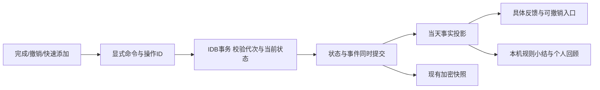

# 课序：日任务、正反馈与每日回顾策划

日期：2026-10-19。状态：产品与实现规划，尚未修改正式业务功能或迁移数据。

用户已选择“具体鼓励＋简洁小结”。沿用课序浅色蓝绿、清晰专业的视觉；本方案不设置综合分、排名、扣分或中断连胜惩罚。体验草案见 [日任务交互原型](daily-tasks-concept.html)，原型只操作内存中的合成数据。

## 1. 页面要帮助用户完成什么

日任务页承担四件事：**选清今天 → 快速做完一件 → 看见具体进展 → 轻松收尾**。用户打开页面，应立即知道现在能做哪一件事，而不必先翻过大型计时器或所有历史待办。

- “今天打算做”与“什么时候截止”是两件事。截止明天的报告可以今天做；逾期很久的待办也不应自动挤满今天。
- 课程/考试是固定安排，待办是行动任务，临时事项是当天插入的工作；分别呈现，避免一件考试因日程和关联待办计两次。
- 反馈评价行动与事实，不推断用户的能力、勤奋程度或心情。零记录不等于什么都没做。
- 每日评价改为用户可掌控的“今日回顾”：事实小结＋自己的感受＋可选的一句话。完全离线可用，AI不是首版依赖。

## 2. 当前实现与需要补齐的基础

以下来自当前源码核对，不把规划描述为已经实现。

| 现有能力/问题 | 位置 | 对本方案的影响 |
|---|---|---|
| 当日课程、考试时间线和课程按日完成状态已存在 | `pages/FocusPage.tsx`、`utils/dayAgenda.ts`、`local/domain.ts` | 继续复用日期和学期边界，不重做课表 |
| 今日待办概要实际是所有未完成待办按截止排序后取前5项 | `FocusPage.tsx` 的 `openTodos` | 新增明确的日计划关系，历史待办放入可选待办池 |
| 已完成列表是所有历史完成项按 `updatedAt` 排序 | `FocusPage.tsx` 的 `completedTodos` | 不能直接用于“今天完成了几项” |
| `Todo` 没有可信完成时间，`updatedAt` 也会因编辑变化 | `types/index.ts`、`local/domain.ts` | 用新的完成/撤销事件与归属日期生成每日事实 |
| 临时任务创建要求截止时间，默认所选日23:59 | `FocusPage.tsx` 的 `openAdd/createTodo` | 标题即保存的日任务独立建模，不能伪造截止日期 |
| `todoApi.toggle()`是翻转，重复请求可能反向改变状态 | `api/index.ts`、`local/domain.ts` | 新日任务接口使用显式完成状态和幂等操作ID |
| 考试关联待办会随时间推进自动完成 | `local/domain.ts` 的 `advanceLocalTime` | 自动结束不能算用户主动完成或参加考试 |
| 计时状态在 `localStorage`，没有可靠的历史专注会话账本 | `FocusPage.tsx` | 首版不虚构“今日专注分钟”；以后有会话记录再展示 |
| 本地主库和快照当前均为严格v1格式 | `local/types.ts`、`validation.ts`、`snapshots/codec.ts` | 新增日计划/回顾必须纳入迁移、导出与加密快照 |

## 3. 页面组织

手机保留“今日”底栏入口；过去日期标题为“回顾”，未来日期为“计划”。桌面同一信息顺序，宽屏右侧可放轻回顾和折叠计时，不再让大圆环占据核心区域。

| 顺序 | 区块 | 内容和主要操作 |
|---|---|---|
| 1 | 日期＋今日进展 | 简短事实，如“今天已完成3项，其中1项为临时事项”；无可靠记录时不填数字 |
| 2 | 我的重点 | 用户自选最多3项，可只选1项或不选；主操作“选入今天/添加重点” |
| 3 | 现在做这一件 | 展开当前选中的任务，显示下一步、可选预计用时；直接完成或开始专注。用户可换另一项 |
| 4 | 今日清单 | 待做/已完成，重点、临时、补记有清晰标记。历史逾期项只放可展开入口，不强制加入 |
| 5 | 固定安排 | 当天课程和考试时间线；“已结束”和“已确认参加”分开，课程考试的统计单独展示 |
| 6 | 今日回顾 | “收个尾”轻入口；事实小结、主观感受、一句话、可选明日第一步 |
| 常驻 | 快速记录 | 单行标题＋“加入今天”；同入口切换“刚刚做完”。键盘展开时不挡输入和发送 |

首屏尽量同时看到一条事实反馈、至少一项可直接勾选完成的重点和快速添加入口。重点区与清单共享状态，不产生第二份任务。没有重点时展示“选一件今天想推进的事”，允许直接跳过；不要求凑满3项。

不再用“后续安排已结束”大卡片占据无课程时的首屏。固定课程结束后，行动区仍能继续处理待办。今日页现有悬浮导入可收进“更多”，避免与快速添加形成两个相互遮挡的主入口。

### 今日任务选入与排序

1. 课程/考试按真实日期出现在固定安排中，不自动填入任务清单。
2. 待办通过“选入今天”建立关联；今日到期、已逾期可作为候选建议，不自动替用户承诺。
3. 临时日任务默认属于当前所选日，没有截止时间也可保存。
4. 重点优先，其余保留用户顺序；指定时段和截止时间只作辅助，不让清单每分钟重新排序。
5. “先做5分钟的小事”可筛选用户填写预计用时不超过5分钟的项目；未填写时长的项目不擅自判为简单。

## 4. 快速完成与撤销

“快速完成”是低操作成本，不是自动判断完成。

| 情况 | 交互 | 数据与反馈规则 |
|---|---|---|
| 完成普通/临时日任务 | 点左侧至少44px勾选区，或键盘Space/Enter | 提交显式 `completed=true`；写入成功后才给成功反馈 |
| 保存中 | 该项显示保存中、阻止连点 | 保留卡片位置，不把同一操作提交两次 |
| 保存成功 | 勾选和小幅淡化，短暂停留后进入已完成 | 约200–400ms轻动效；屏幕阅读器收到简短状态；减少动画时取消位移动效 |
| 快捷撤销 | 反馈条保留“撤销”约6秒 | 撤销同一次完成操作；若记录已被后续操作改变，不盲目翻转 |
| 反馈条已消失 | 在已完成列表中“恢复为待做” | 仍可撤销，不让6秒成为数据恢复期限 |
| 保存失败 | 原任务仍待做、保留滚动与焦点，可重试 | 不先庆祝再报错；草稿和计划保持 |
| 另一标签已完成 | 刷新为实际状态 | 不重复庆祝，不产生第二项成就 |
| 完成→撤销→再完成 | 同一事项回到完成状态 | 当天有效完成仍为1项；重复切换不累计第二份进展或里程碑 |

完成项移动要避免清单立即跳行导致用户误点下一项；保持键盘焦点可预测。批量完成放后续版本的明确选择模式，只给一次汇总反馈，首版不提供“一键全部完成”。

课程使用“确认参加/恢复待确认”，按具体课程发生日记录，不声称用户已经学会知识。考试显示真实时间；关联待办的自动结束只能形成“考试已结束”状态，不能代替用户确认参加。两类固定安排不混入普通任务完成数。

专注结束只提示“本轮计时结束”，不自动完成任务；暂停、关闭或离开页面不会被算成已完成。P0保留现有计时器，不将倒计时长度等同于实际专注时长。

## 5. 临时任务与已做补记

同一输入入口，默认“待会要做”，也可切换“刚刚做完”。

### 待会要做

- 必填只有标题；Enter保存，按钮保存同样可用，中文输入法组合态不触发提交。
- 默认加入所选日，无截止时间。展开后再选预计用时、提醒性质的安排时段或设为重点；首版不提供后台通知承诺。
- 保存成功清空标题并保留输入焦点，方便连续记录；失败保留草稿。空白标题不给提交。
- 同名轻提示“清单里已有同名事项”，仍允许明确创建，不能强制合并真实重复事项。
- 输入“明天交报告”先按标题保留；若以后做自然语言日期识别，必须展示解析结果供确认，不静默改计划日或截止。

### 刚刚做完

- 标题＋归属日期，默认今天。创建与完成事件在同一事务中写入，不能出现“创建成功、完成失败”的半成品。
- 标记“补记”，用“这件事也记下了”认可被忽略的工作；不包装成按时完成计划或有效专注分钟。
- 归属日与实际记录时间分开保存。补记过去日不伪造过去的精确点击时间，不在今天和过去日各算一次。

### 与长期待办的关系

首版保留现有 `Todo.ddl` 必填契约：**临时日任务不等于强行填23:59的长期待办**。

- 日任务统一保存在本机业务库；待办页增加“日任务”入口，能查找未处理的临时事项，避免只在单日页面里失联。
- 既有待办选入今日时只建立引用，不复制出第二份任务或第二个完成状态。
- “转为长期待办”明确填写截止时间；同一事务创建待办并把日任务转换为引用，保留历史关联和完成事实。
- “安排明天”是移动规划关系，不更改原截止时间、不复制业务任务、不把今天未完成变成今天完成。

## 6. 正反馈分层与文案

| 场景 | 示例 | 限制 |
|---|---|---|
| 一项完成 | “已完成：整理实验数据。” | 具体说明完成了什么，不只重复“你真棒” |
| 推进重点 | “今天选定的2项重点，已完成1项。” | 分母来自真实选择；未设置重点不显示0% |
| 临时工作 | “还处理了2件计划外的事，已经记下。” | 单列，不能靠插入小事稀释重点分母 |
| 完成当前重点 | “今天选定的重点已完成，可以留些时间给自己。” | 不暗示所有课程、待办都已完成，不因取消重点假装达成 |
| 调整计划 | “已安排到明天，原截止时间保持不变。” | 调整不是完成；不增加完成数量 |
| 剩余事项 | “还留着2项，可以拆小、改期，或先放下。” | 给实际操作入口，不标红评判整个人 |
| 没有可靠记录 | “今天没有记录也没关系，可以补记一件已做的小事。” | 不把无数据推断成懒惰、失败或休息 |

声音、振动、大面积撒花默认不启用。轻动效和提示不能阻塞连续勾选；多个快速成功合成一条“已完成3项”，而不是叠满屏幕。历史页面、刷新、恢复和跨标签通知不重放庆祝。

没有可累积的“刷分经济”。同一目标在同一归属日只贡献一个当前有效完成；取消、删除、迁出不冒充完成。对重点的新增/换出保留事实，如“最初3项，完成2项，调整1项”，而不是偷偷缩小分母制造满分。

## 7. 每日评价＝今日回顾

主按钮“收个尾”，不是“领取成绩”。可随时打开；晚上在页面前台时最多给一次轻提示，可关闭，不强制弹窗，不承诺关闭应用后定时提醒。

### 三步面板

1. **看见事实**：重点完成情况、有效任务完成、临时处理/补记、课程/考试确认分别展示。补记是完成总数的子集时明确“其中”，避免重复相加。没有记录的指标直接省略。
2. **今天感觉如何**：很充实 / 还可以 / 有点累 / 暂不评价。感受只能由用户选，不能从任务完成率推断。
3. **留一句话（可选）**：“今天值得肯定的是……”；可从未完成项选“明天先做……”，也可以完全不安排。

“保存回顾”才形成已保存状态；“先放着”保留草稿，不标为已评价。保存后可修改；若之后又完成/撤销任务，保留用户感受与文字，提示“事实有更新，点击刷新”，不偷偷重写用户评价。

首版用本机规则生成小结，例如：

> 你今天完成了2项计划，其中1项是重点；另外处理了1件临时事项。还有1项没有做完，可以选一个更小的步骤留给明天。

未全完也可以选择“很充实”，全完也可以选择“有点累”；系统不纠正用户的主观判断。无任务日允许只保存一句话或感受，不制造“0分的一天”。

历史评价仅基于有来源的记录。升级前已完成但不知道何时完成的项目显示“历史完成，日期未记录”，不回填进今天或补造过去的评价。

AI润色放后续：用户主动点击，先预览将发送的统计和文字片段，再走已有可选AI连接；未授权前不发送整份日程，AI输出只能作为可编辑的建议，不自动提交评价或安排明天任务。

## 8. 日期、跨午夜与多课表

- 一个人一份当天计划和回顾，按 `datasetId + businessDate` 组织，不因切课表创建第二套个人临时任务。
- 课程/考试引用携带课表UUID和发生日期；未处于当前课表的固定安排可标明来源，不混入当前课表的编辑动作。
- 初版统一业务时区为 `Asia/Shanghai`，页面、事件、循环规则和每日小结使用同一日期工具；不混用设备本地日期与领域日期。时区配置以后单独设计，旧日记录不随旅行自动改日。
- 午夜不自动标失败、不复制未完任务、不静默搬移正在计时的任务。页面提醒“新的一天到了”，用户可继续收尾或切到今天。
- 历史日默认回顾态；若要更正/补记，显式进入编辑，保留当前记录时间。未来日只安排，不预先完成或生成已完成评价。
- “安排明天”保留原日的迁出事实与目标日关系。下一天只出现一个仍有效的同源任务；原截止已过仍保留真实信息。

## 9. 实现架构与迁移约束

本节是开发方案，不表示相应类型或API已经存在。首轮先在本地主库PWA落地，普通Java桌面路径保持原契约，直到有对应服务能力再开放新增日计划功能。

### 数据与事务

- 新增日计划/日任务关系、完成与撤销事件、每日回顾；每条具有稳定UUID、归属日期、记录时间与来源。普通任务引用既有Todo UUID，不用数组位置或可重映射的数值ID当长期身份。
- 独立日任务可以没有截止；它与日计划关系、将来转换的Todo之间保持同一来源链。实现时使用下表的判别联合，避免同时存在两份可独立完成的状态。
- 事件至少区分 `manual`、`backfill`、`system`、`legacyUnknown`；自动考试结束和来源未知的历史状态不进入“主动完成”投影。
- `recordedAt`记录保存时刻，`attributedDate`记录用户归属日；历史补记的真实发生时间未知时留空，不伪造精确时刻。
- 完成/撤销提交携带 `operationId`、期望状态、数据集/恢复代次及目标版本；在现有 `mutateLocalState` 的同步IDB事务中完成状态、事件与必要循环联动，返回实际变化，成功后才显示反馈。
- 唯一性按目标UUID＋具体发生日/循环发生项判断。撤销需匹配原完成状态版本；旧撤销不能覆盖后续修改。循环下一期已生成时，不因撤销/再完成重复生成，也不自动删除已经开始的新一期。
- `useDailyWorkspace`订阅已有 `subscribeLocalChanges`，使跨标签更新、导入、恢复和删除立即反映到日清单。恢复或换数据集后旧卡片、回顾草稿提交与撤销回调失效。
- 数据和回顾进入IndexedDB核心状态及加密快照；`localStorage`只保留展示偏好，不能成为日计划、历史完成或评价的唯一存储。

最小模型建议（均为拟新增，并非现有接口）：

| 集合 | 关键字段/约束 |
|---|---|
| `dayEntries` | `publicId`、`kind: dayTask/todo`、`plannedDate`、`initialDate`、`origin: planned/adHoc/backfill`、`position`、`isPriority`、创建/更新时间、创建操作ID。独立日任务有标题与当前状态；todo分支仅引用 `todoPublicId`，不能再保存一份独立完成布尔值。同日同Todo只一个有效引用 |
| `dailyEvents` | `publicId`、`operationId`、目标类型/UUID、具体发生日期、`attributedDate`、`recordedAt`、来源、标题快照、原/目标日、原事件引用。除完成/撤销，也记录选入、移日与重点变动，才能解释“最初3项，调整1项” |
| `dailyReviews` | 当日唯一UUID、业务日期、已保存的规则小结/事实计数/指纹/算法版本、已保存感受/文字/时间、独立的草稿感受/文字/时间。保存内容与未提交草稿分开，不能点击“先放着”就覆盖原评价 |
| 接收端元数据 | 新 `dataGeneration`，整体恢复时更新；不从云快照照搬。仅检查 `datasetId` 不够，因为现有恢复会保留接收端数据集ID |

补充规则：

- 首版“转长期”只对未完成日任务提供。已完成的临时成果若需要后续工作，使用明确的“创建后续待办”，不把已完成事项重命名成一份新待做。
- 移日保留同一独立日任务身份，并记录原日、目标日及原重点信息；历史回顾通过事件重建，不靠直接修改 `plannedDate` 后猜测过去。
- 同一全局Todo可被不同日期选入，但完成状态始终只有一个。若已在其他日完成，后来日期显示“已于某日完成”，不能再奖励一次。
- 完成事件来源包含手动、用户确认的AI动作、补记与系统自动。所有日页、待办页、已确认AI提案和考试维护都走同一领域命令，不能让别的写入口绕过事件账本。
- 历史事件保留标题快照与档案UUID，删除原课程/待办后仍可回顾；活动链接遇到删除则显示已移除。档案引用不应被误判成必须永远存在的活动外键。
- 统计显示“有效任务完成总数＝计划完成＋临时/补记完成”；补记是临时成果的子集，使用“其中”说明，不再次相加。重点进度和课程/考试确认分别列出，不加成一个总分。
- 事实指纹只包括该日相关计划、事件和规则版本；普通聊天或无关课表修改不应让回顾失效。用户确认AI完成可以计入事实，但后台数据刷新不弹庆祝。

### 版本与恢复

当前LocalState/逻辑快照均严格为v1，快照集合和字段使用白名单；不能只新增前端数组后让旧导出静默遗漏。

1. 规划本地状态schema2与逻辑snapshot2（建议scope为 `core-with-daily-v2`），保持数据库名称、既有UUID/数值ID、origin和恢复密钥不变；加密信封版本与逻辑数据版本分开，不为加字段更换密钥。
2. 原地事务迁移前保存可恢复的v1数据，迁移失败整体回滚；给旧标签明确的“请更新”路径，不能让旧客户端写回缺少新集合的数据。
3. 保留v1导入适配；新增集合为空，旧完成信息保留为来源/日期未知。不能自动为旧记录造完成事件或每日评价。
4. 继续支持快照预览、修订检查、先保恢复点、手动确认替换；新增集合、引用重映射与恢复代次一并覆盖。恢复v1将缺少新日记录的影响必须在预览中说明。
5. 自动备份、导出、恢复校验及 `scripts/package-local-first.mjs` 的schema/snapshot清单一起升级。密文云仍不解析业务数据。
6. 在现有快照体积上限内验证容量。不能为了压缩大小静默删掉历史事件；接近上限时提示导出/归档，归档策略另行设计。

应用壳更新与数据迁移要分开设计：先确保支持v2的新版本及离线资源准备完成，再由新版执行迁移。旧页遇到schema2必须停止写入并提供加载新版的路径，不能依靠清除网站数据或不断重试；当前PWA更新组件位于应用布局内，需补齐“数据版本不支持、布局尚未挂载”时的升级入口。迁移备份与状态转换必须读取同一份事务内原数据，不能跨两个不一致时刻各取一份。

### 组件和文件范围

| 层 | 计划位置 | 职责 |
|---|---|---|
| 页面 | `pages/FocusPage.tsx`，逐步变为今日页容器 | 日期、选中事项、弹层，不直接拼全部历史待办当今日 |
| 业务视图 | 新 `hooks/useDailyWorkspace.ts` | 数据订阅、加载、提交状态、日期/恢复代次保护 |
| 展示组件 | 新 `components/daily/{DailyProgress,PriorityList,DayTaskRow,QuickTaskComposer,DailyReviewSheet}.tsx` | 单项完成、重点、快速录入、回顾；组件不自行翻转数据库 |
| 领域 | 新 `local/daily/{commands,selectors,review}.ts` | 计划关系、幂等完成/撤销、可信事实投影、离线文案规则 |
| 存储 | `local/types.ts`、`db.ts`、`validation.ts` | schema迁移、原子写入、来源/日期/引用校验 |
| 导入恢复 | `local/snapshots/{codec,restore}.ts` | v1/v2解析、导出白名单、恢复预览、UUID关系映射 |
| 共用入口 | `TodosPage`、`AppContext`、`api/index.ts` | 长期待办引用、日任务查找入口、本地/远端能力区分 |
| 样式 | 独立 `daily-task.css` | 蓝绿视觉、44px操作、移动输入区、减少动画偏好 |

## 10. 分批落地与验收

| 批次 | 交付 | 准入条件 |
|---|---|---|
| A 数据可信 | 日期工具、日计划与事件模型、迁移/快照、显式完成接口 | 旧数据不丢、历史不造假、恢复前后旧操作失效 |
| B 每日执行闭环 | 自选重点、今日选入、单行临时/补记、完成/撤销、可解释反馈 | 标题即可加入；一次完成只计一次；失败保草稿；不依赖网络 |
| C 每日回顾 | 事实小结、主观感受、文字、明日第一步、已保存/草稿/需刷新状态 | 不打分、不自动迁移、不重复统计、不改写用户感受 |
| D 后续增强 | 子步骤、明确选择的批量操作、可信计时会话、可选AI润色 | 不影响首版离线闭环，先验证基础数据再增加指标 |

关键验收场景：

- 标题输入到加入清单只需输入＋一次提交；没有设置时间的临时日任务无伪造截止。
- 中文输入法确认候选不误提交；连续录入保留焦点；同名提示不强制合并。
- 连点完成、请求重试、两标签同时完成、撤销后再完成，均不产生重复有效完成或重复循环下一期。
- 保存失败不庆祝、不丢任务；批量反馈不覆盖输入区；320/390px、200%字号、键盘与减少动画模式可用。
- 到点结束考试不增加主动成就；考试和关联待办只显示一个安排；计时结束不完成任务。
- 改标题、改截止、切课表、补记昨天，不会把旧完成误算到今天；普通临时任务不因切课表消失。
- 未设置重点不出现0%；取消/迁出重点不伪造满额完成；空白日、休息日、未全完均可正常回顾。
- 保存回顾后新增/撤销事项，只更新事实状态提示；不覆写主观感受与文字。
- 跨午夜不丢草稿、不重归属任务；v1迁移与v1/v2快照往返保持引用，旧客户端和恢复前回调不能写坏新数据。

产品观察只在本机或用户自愿测试中验证：录入耗时/步骤、误完成后的撤销是否容易找到、用户能否解释小结数字、是否理解“计划日≠截止日”。不默认采集行为遥测，不把用户打勾更多当作产品成功。

## 11. 可点击草案与本轮验证

[打开单文件交互草案](daily-tasks-concept.html)。可直接用浏览器打开HTML；它无外部资源和业务API，所有示例变化只存在当前页面内存，刷新恢复初始合成数据。本轮仅提交策划、草案和截图，未修改正式业务源码、数据库格式或运行包。

已在本机浏览器实际操作：

- 清单完成、6秒反馈条撤销、已完成列表恢复待做，以及重点区直接完成；有效总数按2→3→2恢复，再完成仍为3，未重复累计。
- 输入标题创建无截止临时任务；切换为补记后创建已完成记录；临时/补记使用“其中”说明，与总数不重复相加。
- 选满3项重点后，第4项被明确提示；安排明天只进入明日区，不增加完成数。
- 保存“还可以”与个人文字后，再完成任务显示事实更新；重新编辑后“先放着”不覆盖原保存内容，再打开保留编辑草稿。
- 1280px桌面布局及390/320px窄屏；320px最终草案文档宽度与可视内容宽度均为305px（另15px为浏览器滚动条），无横向溢出。重点完成控件实测44×44px，输入框16px。

HTML内联脚本语法、ID引用及无外部网络/存储调用已静态核对。中文组合输入防误提交代码已加入；真实中文输入法、手机软键盘、安全区、200%字体、持久化、故障重试、多标签与迁移/快照，仍须在正式实现后逐项验收。本原型未覆盖完整“现在做这一件”和“明日第一步”编辑器，也不能证明离线数据架构已落地。

| 实际草案截图 | 查看 |
|---|---|
| 桌面概览 | [1280px](evidence/daily-concept-desktop-1280.jpg) |
| 手机首屏与常驻快速入口 | [390px](evidence/daily-concept-mobile-390.jpg) |
| 事实小结、个人感受与文字 | [390px回顾](evidence/daily-concept-review-390.jpg) |
