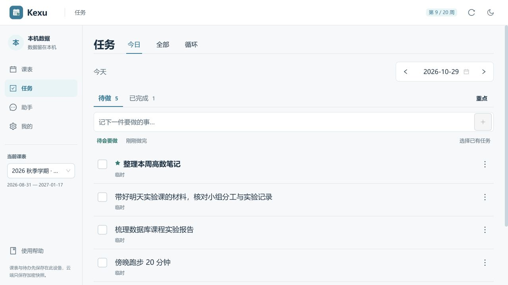
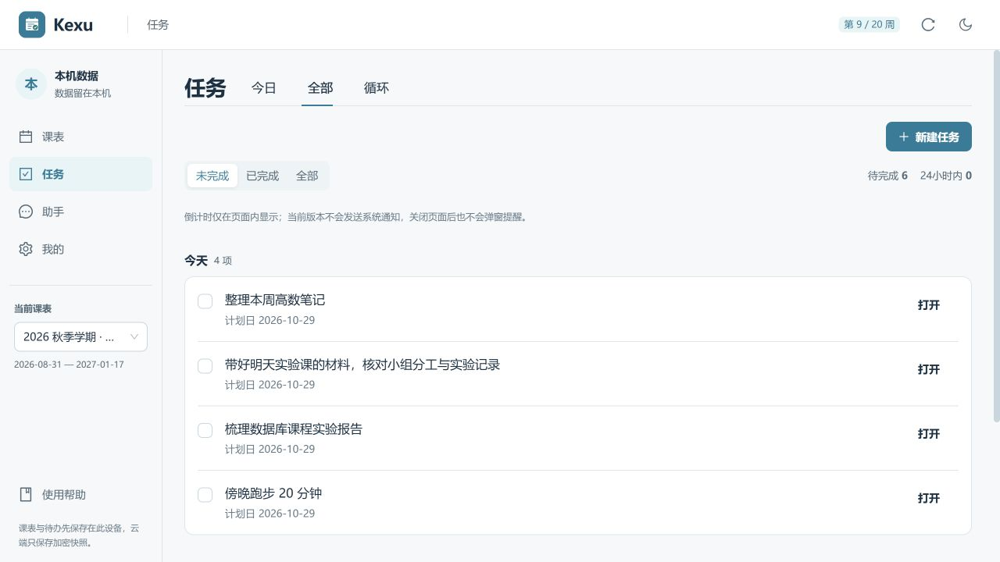
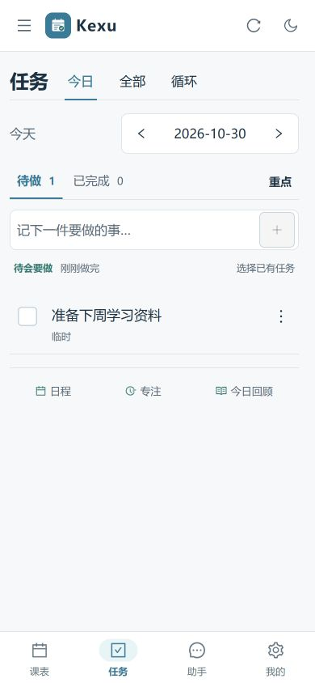

# 今日与待办合并

导航统一为「任务」，在同一个页面内管理当日安排、全部任务与循环规则。默认打开今日清单，避免在两个主导航之间来回寻找同一件事。

## 使用方式

- **今日**：快速记录临时事项、选择已有任务、勾选完成、撤销、设置重点。日程、专注和手动回顾继续位于清单底部。
- **全部**：临时事项和带截止时间的待办共用未完成/已完成/全部筛选，并按逾期、往日安排、今天、接下来和完成状态分组。点击临时事项旁的「打开」进入对应计划日。
- **循环**：保留原循环规则的创建、编辑、启停和触发操作。
- 普通及循环生成的待办可直接「加入今日」，已加入时按钮禁用。今日清单保存的是关联，同一待办在全部列表只显示一次；任一入口完成后状态同步。
- 考试关联任务继续从考试管理修改，不提供加入今日操作。未来临时任务不能提前完成，历史记录需要显式进入更正模式。

## 实现边界

入口为 `/tasks`，`view=today|all|recurring` 选择页内视图，`date=YYYY-MM-DD` 打开对应计划日。旧 `/focus` 与 `/todos` 自动跳转到今日和全部，保留查询参数与 hash。日期同步不改变当前视图，浏览器后退可以返回原来的全部列表；无日期参数时回到今天。

切换标签后今日输入草稿、已打开的任务列表筛选和专注组件继续保留。日期切换保留各日期的临时输入；页面刷新或离开任务页面不会自动保存这些未提交输入。

底部主导航由五项合并为四项：课表、任务、助手、我的。没有改动本地存储结构、记录身份、完成事件语义和恢复保护。联网旧模式继续使用原专注内容，放在同一个任务入口内。

## 本轮验证

- 类型检查、ESLint 和生产构建通过；ESLint 为 0 错误、6 条已有警告，构建仍有 Ant Design 共享分包体积提示。
- 日任务、每日回顾和本地数据核心共 **58 项**回归通过。
- 浏览器验证了新建带截止时间任务、加入今日、完成状态同步、撤销、已加入按钮防重复、未来任务展示与禁止完成。
- 验证了草稿跨标签和跨日期保留、从全部打开指定计划日、旧链接跳转、后退保留原标签、无日期入口回到今天，以及手动打开/关闭今日回顾。
- 检查了桌面 1280px、手机 390px 与 320px，以及 320px 暗色列表。320px 文档宽度为 320px，页面没有横向溢出。
- 使用本机隔离预览和合成任务数据；未进行 Android/iOS 真机验收，APK、EXE 尚未随本次修改重新打包或发布。

## 实际截图

