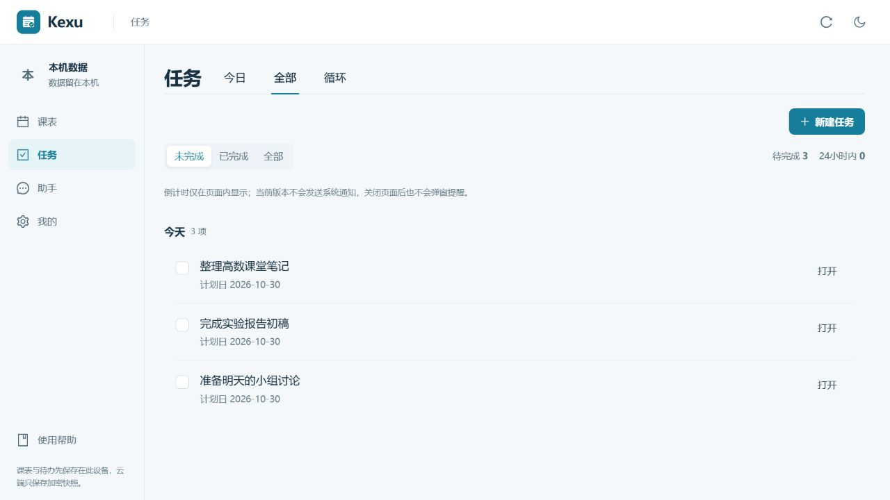
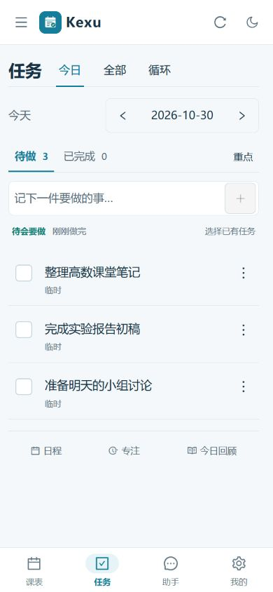
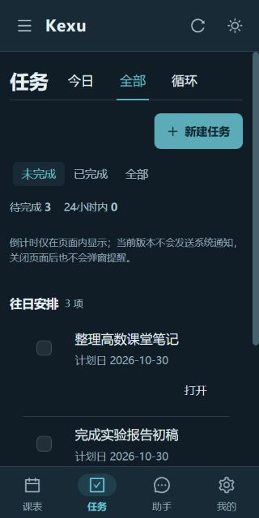
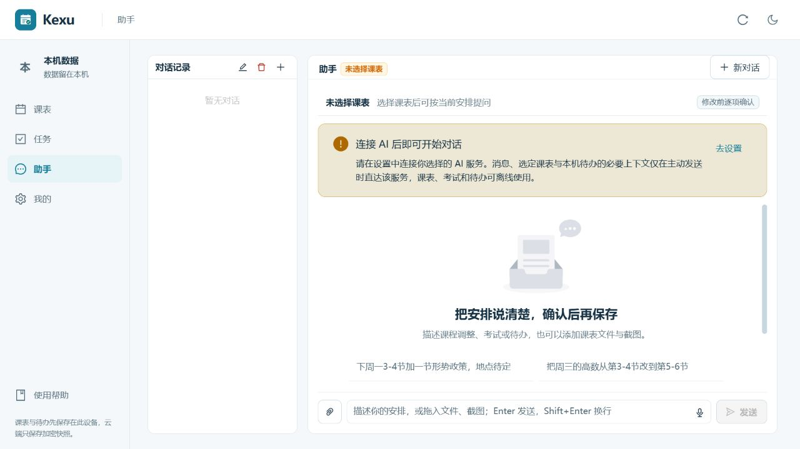
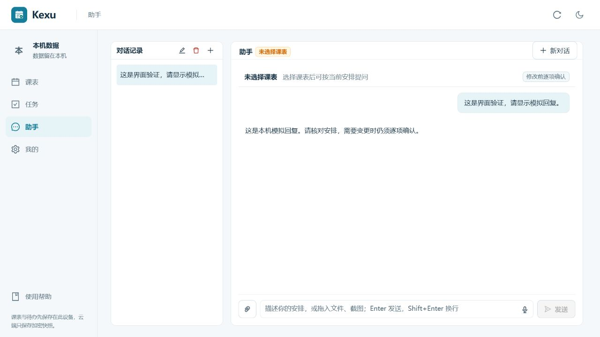
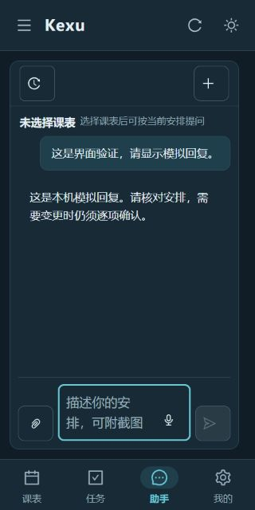

# Kexu 界面精修：减少模板化装饰

开始日期：2026-10-30；完成核对：2026-10-31。

本轮按用户要求采用 Hallmark 的应用界面与精修原则，保留现有布局、蓝绿品牌、系统字体和 Ant Design 控件。重点是让周表、任务和消息成为视觉主体，收敛额外框线、背景色与无差别加粗。

## 实际改动

| 样式文件 | 调整 |
| --- | --- |
| `src/frontend/src/index.css` | 普通及文字按钮改用较轻字重，主要和危险操作保持强调；卡片和表头字重统一为 600。 |
| `src/frontend/src/app-shell.css` | 侧栏“本机数据”图形与周次标记改用中性色，保留品牌图标、选中导航及全部文字。 |
| `src/frontend/src/daily-task.css` | 日期组改透明底，补充即时焦点描边；底部工具图标随按钮文字颜色变化。 |
| `src/frontend/src/daily-pages.css` | 全部任务分组去掉可见外框、圆角和独立底色，保留行分隔与缩进；危险文字使用现有主题变量。 |
| `src/frontend/src/settings-ai.css` | 上下文改透明底与细分隔；示例从卡片改为轻分隔按钮；助手消息去可见外框；选中对话保留底色，取消粗侧条；复用既有主题颜色并强化输入焦点。 |

没有修改 TS/TSX、路由、文案、事件、数据格式、AI 请求或提案执行逻辑。课表自动行高、重叠课程分列、任务完成反馈、撤销、回顾、草稿保留和底部安全区继续沿用原实现。

## 验证

- 本轮开始保存了源码哈希清单，以及五份 CSS 的精修前副本。结束比较确认非 CSS 源文件未改变。
- “全部任务”页面的链接、按钮、输入和标签控件清单与修改前一致。
- 类型检查、lint 和生产构建通过；lint 为 0 错误、6 条已有警告，构建仍有既有大分块提示。
- 日任务、每日回顾和课表布局现有回归测试共 **43 项通过，0 失败**。
- 实际浏览器检查了桌面 1280×720、手机 390×844，以及暗色 320×640。已查页面未发现横向溢出；手机输入计算字号为 16px；日任务完成、更多操作和日期前后按钮保持 44×44px。
- 已实际验证任务完成与撤销、标签切换后草稿保留、浏览器返回、今日回顾打开与关闭、示例只填入输入框，以及键盘焦点。
- 使用本机模拟 AI 服务、合成消息和无效测试 Key 验证了发送、回复显示和选中对话。未调用真实供应商；测试站点的模拟连接已移除。
- 独立复核比较了源码差异和桌面、手机、暗色截图，未发现本轮引入的可复现回归。

本轮浏览器仍能看到既有的 Ant Design 静态 `message` 无法消费动态主题上下文提示，没有因外观精修改动这段行为。未进行物理手机、APK/EXE 或服务器发布验收。此前审查发现的图片失败恢复与混合 PDF 文字合并问题不属于本次样式改动。

## 截图

截图均使用隔离的本机合成数据。任务示例计划日为 2026-10-30，跨日后在最终截图中自然归为“往日安排”。

精修前 CSS、任务截图和哈希清单位于忽略目录 `work/hallmark-polish-2026-10-30/`。本轮未安装 Hallmark，也未运行其 `sloplint`，不将上述人工检查表述为该工具的全项认证。

## 方法依据

- [Hallmark：应用界面](https://github.com/Nutlope/hallmark/blob/main/skills/hallmark/references/flow.md#app-screens)：任务密度、克制强调色、现有外壳和交互状态。
- [Hallmark：改版与精修](https://github.com/Nutlope/hallmark/blob/main/skills/hallmark/references/redesign.md)：保留内容与功能连接，区分精修和结构重设计。
- [Hallmark：交互状态](https://github.com/Nutlope/hallmark/blob/main/skills/hallmark/references/interaction-and-states.md)：焦点、触控目标和操作反馈。
