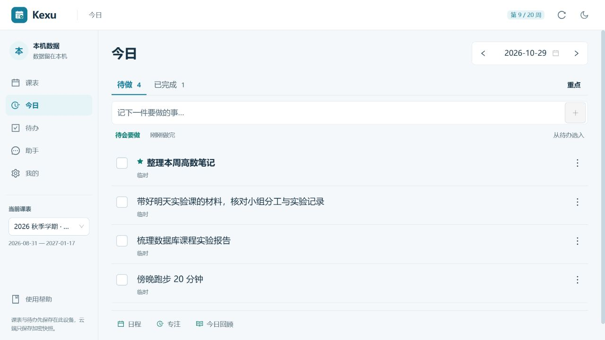
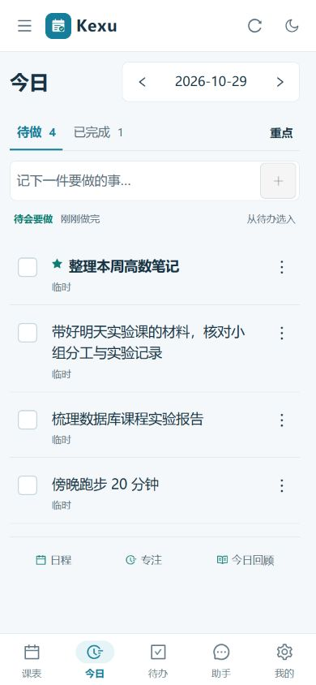
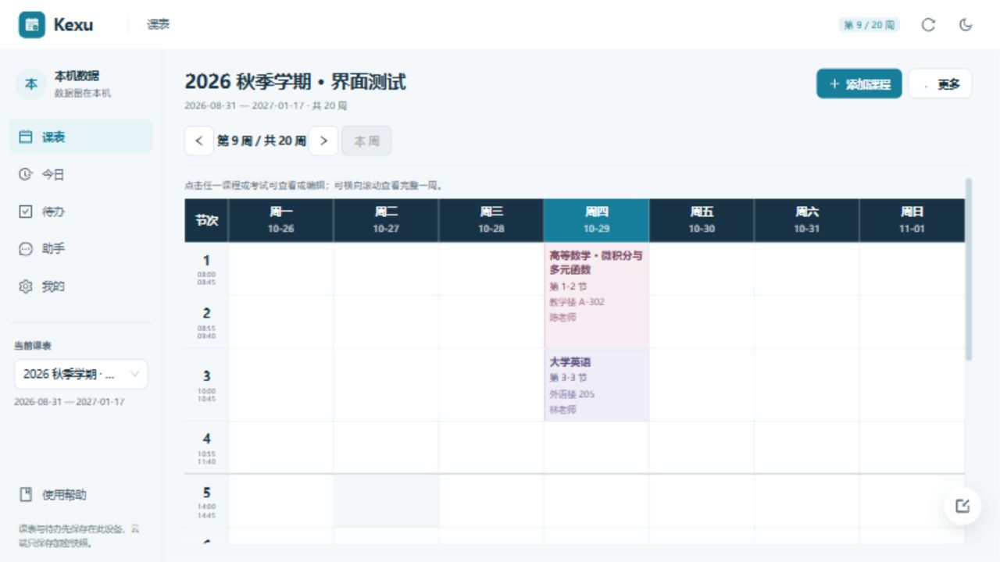

# Kexu 界面精简与排版优化

本轮沿用浅色蓝绿视觉方向，让学生打开应用后先看清课程和要做的事。减少重复卡片、粗彩色边框和大完成控件，以时间列、分隔线和文字层级组织内容。

## 已实施

- **今日**：快速记录移到列表上方；待做/已完成改用下划线页签；普通任务用紧凑清单行，重点任务用星标和加重文字表示。完成按钮保留 44px 点击区域，内部标记收小；小特效、撤销和手动回顾保留。
- **课表入口**：统一只展示周表，移除按日和全部课程切换，手机端也直接进入周表。保留上一周、下一周、本周、课程编辑与考试管理；窄屏在课表区域横向滑动。内置使用帮助同步更新。
- **周课表**：减轻外框和课程边框，长课程名完整换行。显式定位、行高计算和溢出保护保留。
- **公共界面**：缩小顶部和侧栏占用，统一图标；减少投影和重复说明；补足浅色与暗色输入占位文字对比度。手机课表标题与主要操作同行显示。

## 实际效果

以下为本机隔离预览中的合成课表和任务，没有使用真实用户资料。

### 桌面今日页

### 手机今日页

### 周课表

## 本轮验证

- `npm run typecheck`、`npm run lint`、`npm run build` 均通过；lint 为 0 错误、7 条已有警告，构建仍提示 Ant Design 共享分包超过 1200 kB。
- 日任务核心、每日回顾、周课表布局及按日课表共 50 项回归通过。最后一次边框调整后，又复验了周课表的 10 项布局测试，全部通过。
- 浏览器检查了 1280px 桌面、768px、390px 和 320px 宽度，以及窄屏暗色模式。320px 页面没有横向溢出，任务完成点击区域为 44×44px，快速输入字号为 16px。
- 通过界面验证新增、设为重点、完成、撤销、手动打开和关闭今日回顾，以及周次切换、返回本周、长课程名称展示与打开课程编辑。
- 课表固定周表后重新通过 `typecheck`、`lint` 和 `build`；559px 窄屏确认只有课表区域横向滚动，页面无横向溢出，并核对了 1280px 桌面显示。
- 静态设计检查指出的 3 处旧粗边框样式已减轻。独立代码审查未发现阻碍问题。
- 浏览器控制台仍有 Ant Design 已有的 `destroyOnClose` 弃用、未连接 Form 实例及静态 message 不消费主题上下文警告；操作验证中没有观察到功能中断。这些迁移问题不作为本轮已解决项。

## 边界

本轮修改共用前端，不改变本地数据身份、存储结构、备份恢复和 AI 提案确认流程。验证使用桌面浏览器及响应式尺寸模拟，未宣称通过 Android/iOS 真机验收；APK、EXE 和 GitHub Release 尚未随这轮 UI 修改重新打包或发布。
