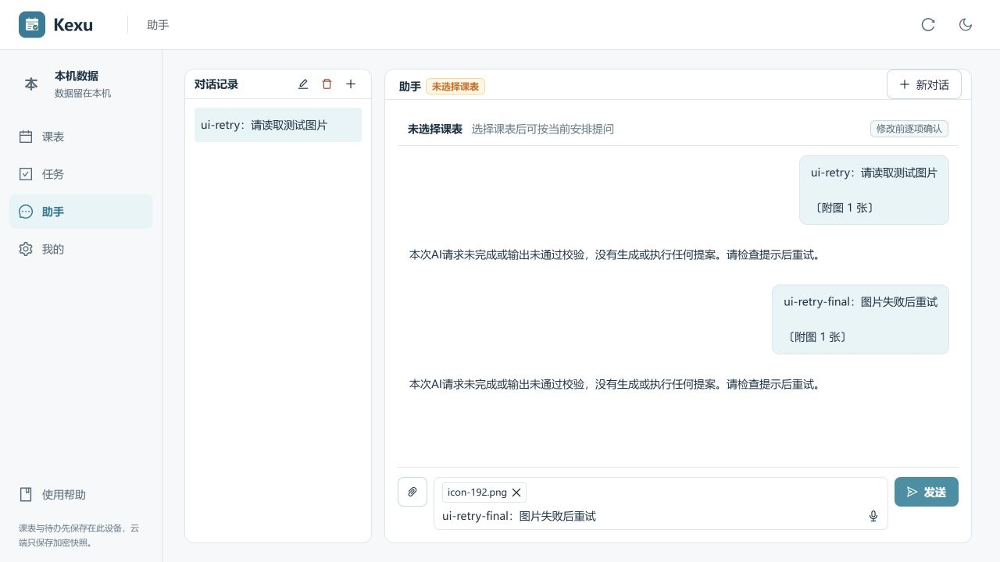
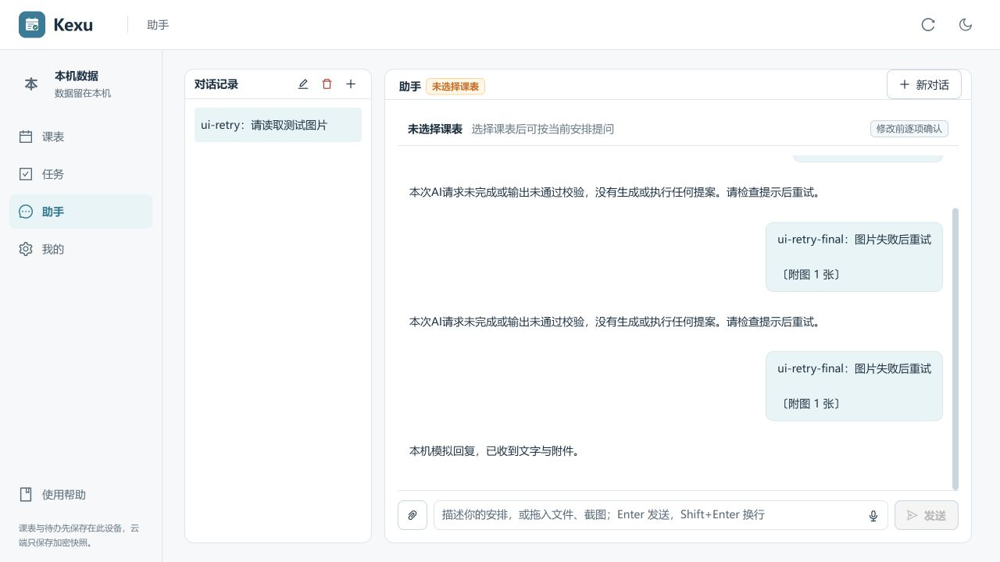
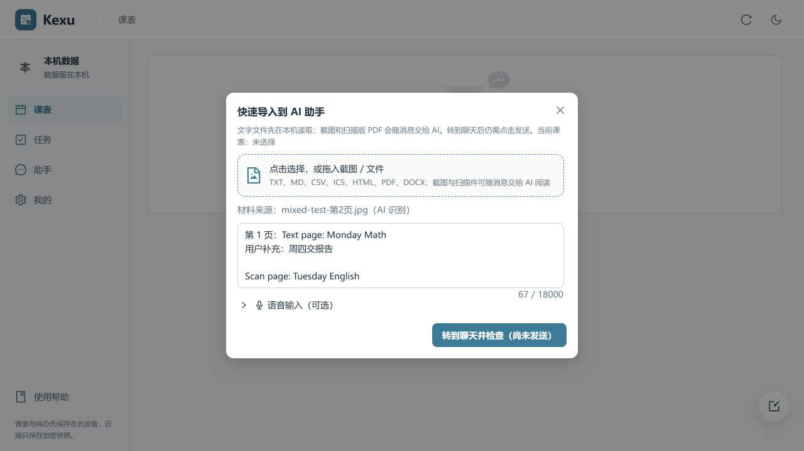
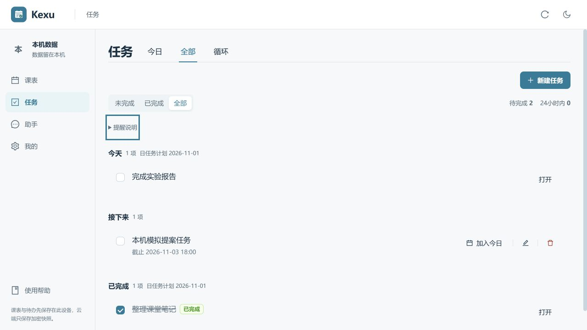
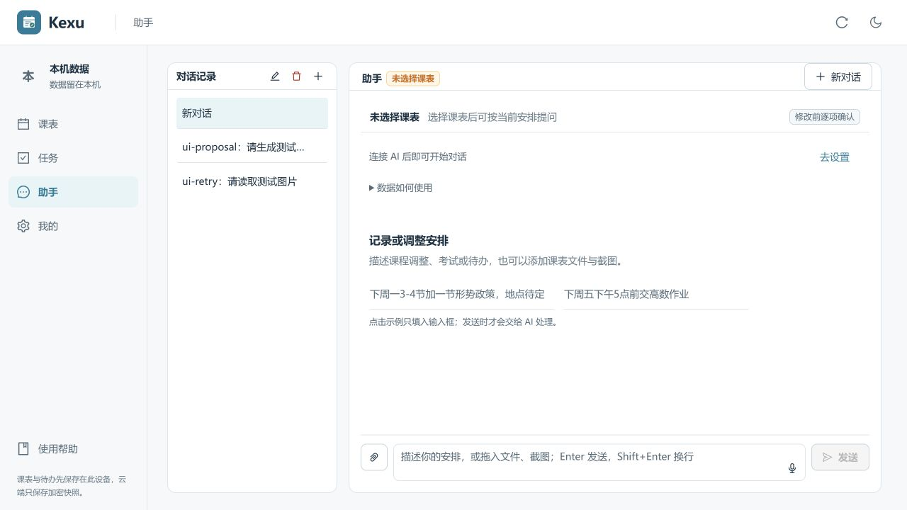
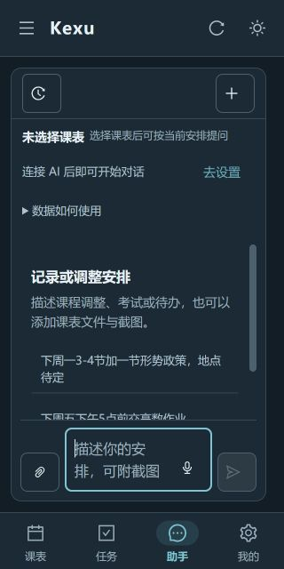

# Kexu 交互修复与信息精简

开始日期：2026-10-31；验收日期：2026-11-01。

本轮完成五项已确认优化，延续既有简洁界面、蓝绿配色和周表/任务/助手入口。

## 完成内容

1. **图片失败后完整重试**：发送结果明确区分成功和失败；文字与附件保留到发送成功，断网、鉴权失败和主动停止后均可继续。首条消息自动创建会话时保持草稿；手动切换会话、新会话、课表、恢复数据集或卸载会使旧结果失效。同数值会话 ID 对应不同 UUID 时也清理旧草稿。成功回复已保存但刷新失败时，不把它当成发送失败重发。
2. **混合 PDF 与 OCR 原子合并**：先合并文字页、手工补充及完整 OCR 结果，再校验 18000 字上限。识别失败、后续页面失败或合并超限时保留原文字和所有图片；关闭、切换课表或卸载后丢弃迟到结果。
3. **压缩任务重复信息**：同组日任务的相同计划日期只在组标题说明一次；不同日期仍逐行显示完整日期。普通待办保留精确截止时间，逾期与 24 小时内的倒计时继续突出。循环和考试来源仍可查看，提醒能力说明可按需展开。
4. **筛选保留**：列表通过 URL 的 `taskFilter=active|completed|all` 保存选择。刷新、后退/前进和切换主标签后仍保持；无效值回退未完成，原有日期、其他参数和 hash 保留。打开计划日也保留列表筛选。
5. **助手空态与反馈精简**：移除大插画，使用短标题和课程、待办各一条原示例。AI 配置缺失改为紧凑设置入口，原隐私说明完整保留在“数据如何使用”中。普通提案成功由卡片的“已执行”状态表达；新课表创建提示、执行失败和刷新失败提示保留。

保留逐项确认提案、删除确认、完成小特效、撤销、今日回顾、离线存储和旧路由兼容。图片与 Key 不写入业务数据库或快照；失败草稿仍是当前页面的临时状态，刷新或关闭页面不会持久保存图片。

## 自动验证

- 完整前端回归：**220 项通过，0 失败、0 跳过**。
- 新增组件流程回归：聊天草稿 18 项、导入材料 10 项、筛选与日期展示 6 项，共 34 项；均已接入 GitHub CI。
- 类型检查通过；lint 为 0 错误、6 条已有警告；生产构建通过，既有大分块提示仍在。
- 新增 `npm run test:interaction` 可单独运行上述 34 项。
- 检查日志：`work/ux-fixes-2026-10-31/regression-final.log`；精修前文件副本位于同目录 `before/`。

新增测试直接驱动实际 Page/Composer/导入组件及其回调，覆盖首条自动创建、失败重试、停止、忽略取消的迟到成功、切换、数据替换、卸载、新草稿保护、重复 Enter、REST OCR 重试、导入意图、超限和导航状态。

以上为提交前的本地验证记录；新增测试已纳入 CI 配置，GitHub Actions 的在线结果以对应提交或 PR 的检查页面为准。

## 实际浏览器验收

- 图片请求收到本机模拟 HTTP 401 后，文字和图片标签仍在；直接重试成功后原草稿清空。
- 主动停止保留文字与图片；新建会话清空旧附件。
- 待办提案仍需点击“确认执行”；执行后显示“已执行”，没有重复成功弹窗。
- 两页合成 PDF 的文字页、用户补充及扫描页模拟 OCR 内容同时保留。
- 已完成筛选刷新后保留，浏览器返回和主标签切换均保留筛选。
- 原生折叠说明支持键盘 Enter；隐私和提醒原文可读。
- 桌面、390×844 手机、320×640 暗色检查；所查页面没有横向溢出，聊天输入框计算字号为 16px。

仅使用独立 `127.0.0.1:5193` 测试站点、本机模拟服务、公开图标、合成 PDF 和无效测试 Key。模拟连接已从测试站点移除；未调用真实 AI，未读取真实用户数据库。未进行物理手机、APK/EXE 或线上部署验收。

## 截图

