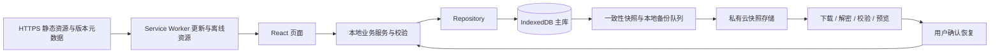

# 本地主数据、自动云快照与版本分发

确认日期：2026-10-18。状态：本地主库、自动加密快照、手动恢复和可选AI本地提案已实现并进入开发验收；生产部署仍受网络阻断。实际结果见 [验收报告](ACCEPTANCE_2026_10_18.md)。下文设计中尚未落地的扩展项以报告为准。

## 当前实现映射

- `local/db.ts`：版本化IndexedDB单工作区记录，原子读写事务与跨标签通知；目前不是每实体独立object store。
- `local/domain.ts` 与 `validation.ts`：业务校验、联动、级联、循环补算及本地API适配；UUID稳定标识与设备内数字ID并存，恢复后数字ID递增，避免旧表单误改。
- `local/snapshots/`、`backup/`：UUID逻辑快照、AES-GCM、独立备份队列、重试租约、手动预览/CAS恢复。
- `src/cloud/server.mjs`：`/api/v1/`加密对象服务。限额、所有权、幂等与原子存储独立于业务库。
- `pwa/`：全资源预缓存、完整准备状态、更新确认及更新前恢复点。发行包另带manifest与SHA256；没有单独的自动stable频道发现协议。
- `local/ai/`：本地聊天与确认执行、最小上下文直连用户选定供应商；不在云快照服务追加AI代理。
- 核心快照不含偏好、聊天、附件、凭据。桌面H2迁移、跨端自动合并和后台准点执行仍未实现。

用户确认：主要数据全部保存在本地，云只提供数据快照与存储、更新发布与下载；自动备份，恢复时手动确认。这一决定取代 2026-10-12 联网首版中“Java 服务器保存业务主数据”的目标。原生 Android 方案继续暂停，本轮沿用 PWA 路线。

## 数据所有权

“本地”指正在使用应用的设备。手机 PWA 的主库在手机浏览器内，不是手机远程访问电脑或服务器上的 H2。

| 数据/能力 | 设备端 | 云端 |
|---|---|---|
| 课表、课程、考试、待办、节次、循环规则、专注完成记录 | 本地数据库为唯一日常读写来源，断网也可操作 | 只作为快照中的副本保存，不提供这些实体的在线 CRUD |
| 字体、主题、会话与草稿 | 本地保存；备份范围逐项声明 | 仅保存用户允许进入快照的内容 |
| 云快照 | 本地生成、校验、加密；恢复由本地执行 | 带鉴权的对象上传、列表、下载、删除及配额管理 |
| 应用更新 | 下载并核对资源，保留旧版本，提示确认切换 | HTTPS 静态站、发行包及版本元数据 |
| 云登录与网络错误 | 只影响备份/下载状态，不阻断本地使用 | 不参与本地业务授权，不决定本地数据是否存在 |

云端可以保存备份身份、对象归属、大小、哈希和版本等必要元数据；这些不是课表业务主库。此设计不提供实时多端合并。手机与电脑通过“创建快照 → 下载 → 确认恢复”搬运数据，不按云端时间戳自动覆盖另一台设备。

## PWA 本地架构

采用 IndexedDB 的事务与索引能力保存结构化主数据，Cache Storage 只保存公共应用资源。不能把 REST 响应缓存或 localStorage 当作新的业务主库。

拟新增模块：

| 位置 | 职责 |
|---|---|
| `src/frontend/src/local/db.ts` | IndexedDB schema、版本迁移、事务与存储错误处理 |
| `src/frontend/src/local/repositories.ts` | 课表、课程、考试、待办等数据访问接口 |
| `src/frontend/src/local/domainService.ts` | 所有权、校验、考试待办联动、级联删除、循环补算与幂等 |
| `src/frontend/src/local/snapshots/` | 逻辑快照序列化、校验、加密封装、本地导出与确认恢复 |
| `src/frontend/src/backup/` | 云授权、持久化上传队列、重试与备份状态 |
| `src/frontend/src/releases/` | 版本查询、资源核对、兼容性检查与更新确认 |

上述路径是规划，不表示文件已经实现。现有 React 页面、手机布局、日期视图及提案确认交互可复用；业务服务应通过 Repository 接口调用本地事务，不在 `request()` 中按联网状态切换本地/远端两套主数据。

本地初始化创建自己的数据空间即可进入主界面。云端凭据过期、401、断网不能清空本地数据，也不能把用户送回阻断全部业务的服务器连接页。跨标签页写入需要事务、版本通知与单实例备份协调，不能只依赖内存状态。

本地表至少涵盖 schedules、periodConfigs、courses、exams、todos、recurringRules、recurringOccurrences、focusCompletions、datasetMeta、backupJobs。聊天及偏好使用单独集合，按已声明范围备份。

实体使用稳定 UUID；关联引用 UUID。旧 BIGINT ID 通过显式映射转换，读取时先保留为字符串，避免 JavaScript 整数精度丢失。考试、待办保留当地日期时间及 IANA 时区；修订时间使用 UTC，不能把原有墙钟时间直接当 UTC。

考试与考试待办在同一事务新增、更新和删除。循环任务保留发生项唯一键、触发游标与链式状态，恢复和前台补算不能重复生成待办。CUSTOM 脚本先保存为不可执行数据，不因导入或恢复而运行。PWA 关闭后不承诺循环调度、提醒或操作系统闹钟准时执行。

## 自动备份协议

用户已选择自动备份。备份服务配置完成后自动工作；配置未完成时本地功能照常使用，并明确显示“尚未连接云备份”。

1. 每次本地业务事务成功，递增 `localRevision`，同时持久保存“待备份”标记。界面此时即可报告“已保存到本机”，不等待上传。
2. 应用运行时，对连续写入防抖后生成一致性全量快照。首版建议防抖 60 秒、自动上传最短间隔 5 分钟；这些是可调默认值，不是已测性能指标。
3. 启动、回到前台、网络恢复时检查待备份任务。在事务中读取同一修订的数据；加密和上传在事务外完成，避免长时间占用数据库。
4. 未发出的旧任务可合并为较新的修订。已发送对象保持不可变，重试复用同一 `snapshotId`、同一密文和校验值，服务端按 ID 幂等处理。
5. 只有上传完成且服务器返回的对象大小、哈希吻合后，才在本地事务中更新备份状态。任务须仍属于当前备份空间与本地数据集；以 `max(lastBackedUpRevision, capturedRevision)` 更新水位，仅当当前修订不高于该水位时清除待备份标记。上传期间的新写入继续待备份，旧请求晚到或切换备份空间后的回包不得污染当前状态。
6. 断网或失败时保留本地数据及队列，采用有上限的退避重试；下一次前台运行继续。不能将 `online` 事件或发出请求视为上传成功。
7. 多标签页通过锁和持久任务状态领取上传，避免重复流量。云端满额或授权失效要显示原因，不删除本地内容来“解决”错误。

PWA 的后台执行受浏览器及操作系统调度限制。首版以应用运行、回到前台和恢复联网后的自动备份为可靠路径，不承诺关闭应用后的固定时刻上传，也不依赖 Background Sync 才能补传。

界面分别展示：本地保存状态、待备份修订、最近成功云快照时间、备份错误、最近可恢复版本。不得只显示一个容易混淆本地保存与云上传的“已同步”。

## 逻辑快照与恢复

拟定新格式名 `tangent-local-snapshot`；外层包含格式版本、快照 ID、创建时间、来源设备/数据集标识、应用版本、数据 schema 版本、大小、密文哈希及加密封装版本。加密负载包含业务集合、引用及各集合数量。云仅保存密文对象及必要索引；加密方案、恢复密钥导出和配额参数须在云上传实现前定稿并验证。

自动加密所需密钥留在设备；恢复凭证需由用户另行保存，服务器不保存解密密钥。未经验证的密钥恢复流程不能宣称“云备份可恢复”。本地业务与普通本地导出不因此被阻断。

核心快照应覆盖课表、节次、课程、考试、待办、循环规则/发生状态及专注完成记录。字体等偏好走明确白名单。AI 历史及附件是否包含必须在备份范围中明确显示；不支持的集合不能静默丢弃后宣称全量备份。

排除云令牌、API Key、账号角色、管理员标记、设备认证密钥、解密主密钥、DPAPI、环境变量和整个 localStorage。临时请求队列、进行中的计时、可执行 AI 提案和系统权限不作为可执行状态恢复；需要保留的 AI 操作只能作为不可执行历史。

现有 `DesktopBackupServiceImpl` 生成的 `tangent-h2-backup` 是全库物理备份，含账号凭据，只供原桌面恢复工具使用，不能直接上传为本方案的手机快照。现有 [exchange v1](../android/EXCHANGE_FORMAT_V1.md) 也不是完整快照：当前只支持部分实体，循环/提醒集合尚不接收内容，且明确排除 AI 历史。新的逻辑快照及桌面适配器必须分别实现，不能借旧格式名称宣称互通。

恢复流程固定为：下载或选文件 → 大小与格式检查 → 解密及完整性验证 → schema/日期/引用/唯一性检查 → 展示数据数量、来源时间和将被替换范围 → 保存当前本地恢复点 → 用户确认 → 在单个本地事务中替换业务数据。恢复出错整笔回滚，保留旧库；不自动合并，不执行脚本或旧 AI 提案。

恢复点保存失败则中止替换。执行替换的事务须检查当前 `localRevision` 仍等于预览及恢复点捕获的修订；期间本窗口或其他标签页有新写入时，停止恢复、重新预览和保存恢复点，再请求确认，不能沿用旧确认覆盖新数据。

恢复不得替换接收设备身份、云认证或加密凭据。来源数据集 ID 只作溯源；接收设备本地身份仍由自身管理。恢复后本地修订递增，重新建立备份任务及派生索引，取消悬空计时目标，随后按本地规则补算循环任务。

## 云端最小接口与服务器职责

以下为接口草案，当前尚未实现：

- `POST /api/snapshots`：上传不可变加密快照，强制鉴权、归属、大小/容量限制与幂等校验。
- `GET /api/snapshots`：分页列出当前授权空间的快照元数据。
- `GET /api/snapshots/{id}/content`：鉴权下载自己有权访问的密文。
- `DELETE /api/snapshots/{id}`：按明确保留策略删除自己的对象；对象 ID 本身不是访问权限。
- `/releases/stable.json`、带版本的资源目录及发行包：公开应用更新元数据和文件，不放私人备份。

静态站可由 Nginx 提供；快照服务独立运行，端口遵守共享服务器约定并在部署前确认占用。快照元数据可以使用轻量索引数据库，但不再部署原有课表 Java 业务库作为云端主数据源。私人快照不放在 Nginx 公开静态目录或 GitHub 中，也不沿用共享 root 私钥作为应用层访问凭证。

首版仍可保留桌面上的本机 Java/H2；它是电脑端本地实现。手机与桌面互通需要显式逻辑快照适配与往返验证，不能把服务器 H2 副本当作同步中枢。

## 更新与数据升级

版本元数据包含应用版本、资源清单/哈希、支持的快照/schema 范围和下载位置。HTTPS 来源用于发布入口信任，哈希用于检查字节完整性，不能单独把哈希等同于发布者身份验证。

Service Worker 预缓存所有核心路由及其动态依赖，完成后才显示“已准备离线”。当前仅缓存已访问的懒加载页面不足以支持首次离线打开待办、专注、设置。PDF/DOCX 等重资源可以单列可选离线包并显示下载状态。

更新代码和恢复数据是不同操作。下载新版本不更改课表；切换版本前完成本地保存、记录恢复点并检查迁移兼容性。IndexedDB schema 升级失败须回滚；已成功升级但不再兼容旧代码时，不强制切回旧代码并继续写库。保留旧静态资源，云备份接口和带凭据请求不进入公共缓存。

请求 `navigator.storage.persist()` 并处理拒绝，展示存储余量与本地导出入口。浏览器仍可能因用户清理、无痕会话结束或存储策略丢失数据，不能宣称 IndexedDB 永久不丢；持久化请求不替代云快照和本地文件导出。固定应用域名，迁移 origin 前提供导出/导入路径。

## AI 的边界

当前 AI 服务从服务器业务库收集上下文并在服务器执行提案，不能直接沿用到本方案。会话、消息和提案状态应先本地化，确认后的动作通过本地业务服务事务执行。

严格遵循“本项目云只做快照与发布”时，云快照服务不增加 AI 推理代理或会话主库。若后续保留联网 AI，应单独确定用户主动连接的推理服务、CORS/凭据和最小上下文发送方式；本轮不擅自放宽云职责，也不把这项待决策功能作为本地课表可用性的条件。当前旧 AI 链路在切换前不能宣称符合新边界。

## 实施顺序与验收

| 阶段 | 交付与验收门槛 |
|---|---|
| A 本地主库 | 移除业务入口云登录门槛；IndexedDB、课表/课程/考试/待办/节次与事务联动；断网编辑后刷新和重开仍存在。 |
| B 离线完整性 | 核心页面首次离线访问、本地循环与专注、跨标签页一致性；本地文件导出及预览恢复，非法文件不改变现有库。 |
| C 自动云快照 | 密钥恢复可验证、鉴权/配额、持久队列、自动上传重试、修订竞争/重复提交处理、手动确认恢复、篡改及跨账号拒绝。 |
| D 更新分发 | HTTPS 安装、完整离线资源、版本下载、保存后切换、迁移失败回滚、旧资源兼容；更新不覆盖用户数据。 |
| E 可选能力 | 桌面逻辑快照往返、AI 本地上下文与提案执行；不能把未支持内容静默迁移到线上主库。 |

最关键的验收是：断开服务器后仍能使用核心业务；断网修改不会变成“等待云端成功才保存”；云授权失效不影响本地主库；自动备份失败可以补传；恢复未经确认绝不改变本地；更新不清空、降级或覆盖用户数据。

本轮新增本地主库、离线资源、加密快照与AI提案检查，结果单列在验收报告；此前26项前端/29项Java HTTP属于旧联网包，不计入本地版通过数。真实断电、物理手机和生产HTTPS仍需单列验收。

## 技术依据

- [MDN IndexedDB](https://developer.mozilla.org/en-US/docs/Web/API/IndexedDB_API)：浏览器结构化数据与事务。
- [MDN 持久化请求](https://developer.mozilla.org/en-US/docs/Web/API/StorageManager/persist)：请求可能被拒绝，需处理返回值。
- [MDN 存储配额与清理](https://developer.mozilla.org/en-US/docs/Web/API/Storage_API/Storage_quotas_and_eviction_criteria)：浏览器数据的保存与删除边界。
- [MDN PWA 离线与后台任务](https://developer.mozilla.org/en-US/docs/Web/Progressive_web_apps/Guides/Offline_and_background_operation)：后台执行依赖浏览器调度。
