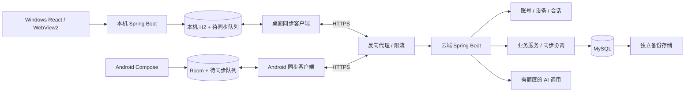

# 手机、电脑统一账号与云同步上线方案

日期：2026-09-28。审阅源码基线：`6114f1a`。状态：规划稿，未实施云账号、同步或服务器部署。

建议采用“离线可用、按需登录、云端协调同步”：Windows 保留本机 H2，Android 保留 Room，云端复用 Spring Boot 业务层并使用 MySQL。登录后同一账号的手机与电脑同步；不登录仍能使用本地课表。首次开通同步需要确认身份及上传范围，此后设备自动续期登录。

尚未确定发布地区、用户规模和预算，本文暂按 **100～1000 名注册用户、先邀请制内测、主要中文用户、Android + Windows 首发** 规划。注册人数不能换算成并发能力；配置和性能目标都需要上线前测量。iOS 预留协议兼容，客户端开发另列阶段。本轮交付设计和实施清单，没有购买资源、上传用户数据或改变当前登录行为。

## 1. 现状与上线前的缺口

| 当前事实 | 对上线的影响 | 对应源码或说明 |
|---|---|---|
| 后端以原始 `api_key` 作为身份和多张业务表的外键；课程、考试通过课表关联身份 | 无法直接表达一个账号下多台设备及独立撤销会话；凭据更换不应影响业务归属 | `src/backend/src/main/resources/db/migration/mysql/V1__initial_schema.sql`、`V2__roles_action_workspace_and_recurring_cursor.sql` |
| 浏览器生成设备凭据并自动注册；注册限额是每个进程每分钟 60 个 | 属于本机自动进入工作区，不能证明两台设备属于同一人；不适合作为公网无限注册入口 | `src/backend/src/main/java/com/timetable/service/impl/ApiKeyServiceImpl.java`；[设备登录说明](DEVICE_AUTO_LOGIN.md) |
| `period_config` 只有节次主键，修改需管理员权限 | 云端不同用户不能共用一张可修改作息表，必须先调整数据归属 | `src/backend/src/main/java/com/timetable/service/impl/PeriodConfigServiceImpl.java` |
| Windows 使用本地 Java + H2，桌面凭据由 DPAPI 保护 | 可以保持离线能力；云端账号与本机进程访问凭据要分开保存和使用 | `src/backend/src/main/resources/application-standalone.yml`；`src/desktop/shell/DesktopSecurity.cs` |
| Android 已有课表、课程、考试、待办及稳定 UUID，UI 从 Room 读取 | 可以复用本地模型，但现有 revision 不能直接充当服务器同步版本 | `src/android/app/src/main/java/com/tangent/timetable/core/database/Entities.kt`、`data/TimetableRepository.kt` |
| Android JSON v1 支持上述实体，循环和提醒数组必须为空；桌面交换适配器尚缺 | 文件格式不是已经实现的跨端同步协议，需要字段对齐和实际往返验证 | [交换格式](../android/EXCHANGE_FORMAT_V1.md) |
| 后端待办 ddl 必填；Android dueAt 可空且另有 details；Android 课程还有 note/colorHex | 直接照搬现有 REST DTO 会丢字段或拒绝合法手机数据，需要规范统一模型 | 后端 V1 迁移；Android `Entities.kt` |
| AI 由服务端生成待确认提案；本机密钥设置受配置和权限限制 | 保留确认边界；多用户云端增加独立用量、额度和执行版本检查 | `src/backend/src/main/java/com/timetable/controller/AiController.java`、`service/impl/AiServiceImpl.java` |
| 循环规则可执行 Rhino 脚本；调度时区目前固定 Asia/Shanghai | 公网先仅支持结构化规则；不能直接开放不可信脚本，也不能让两端独立生成同一任务 | [当前架构](PROJECT_UNDERSTANDING.md)、[剩余事项](CURRENT_ISSUES.md) |

Android 文档仍记录尚无已验证 APK；Windows 最新源码也不能等同于已重新打包的发行版。这些是进入内测前的交付门槛，本轮没有重跑工具安装、编译或真机检查。

## 2. 用户体验与同步范围

第一次打开继续直接进入本地课表。设置中增加“账号与同步”，首次开通时验证邮箱，展示本地和云端各有多少课表、课程、考试及待办，用户确认后导入或合并。第二台设备登录同一账号后拉取云端数据，不要求复制 API Key。

账号页只需要显示账号、设备列表、最近同步时间、待上传数量及冲突入口。课表正常离线使用；网络故障显示“已保存到本机，等待同步”，不能显示“同步成功”。退出账号先提示待上传内容，再选择保留本机副本或清除该账号缓存。切换账号必须切换独立缓存与同步队列，不能把前一个账号的资料上传给后一个账号。

| 范围 | 第一期决策 |
|---|---|
| 课表、课程、考试、普通待办、考试关联待办、作息方案 | 同步，作为跨端可用的首个完整范围 |
| 循环规则及已生成记录 | 下一阶段；未支持客户端不可编辑/全量替换这些实体，也不能把“不认识”当作删除 |
| AI 提案产生的课程、考试、待办 | 用户确认后成为普通业务变更，走同一同步机制 |
| AI 对话与尚未确认的提案 | 第一阶段不作为跨端离线同步数据；云端对话可在后续作为独立在线功能开放 |
| 截图、原始文件、音频 | 默认不长期保存到云端；按用户触发的识别请求处理，成功后同步结构化结果 |
| 提醒时间偏好 | 后续可同步；系统通知授权、麦克风授权、语音许可勾选及通知调度状态保持设备独立 |
| DeepSeek Key、设备凭据、会话令牌 | 不进入业务同步、交换文件和普通备份导出 |

手机和电脑上的自动登录依赖已建立的可撤销会话，不采集 MAC、IMEI 或硬件指纹来判断账号。两台从未关联的设备无法安全地凭空识别为同一用户，首次身份验证或已登录设备授权是必要步骤。

## 3. 推荐架构与工程边界



后端先采用单体服务，按账号、课表业务、同步、AI、运维划分代码模块，继续 Controller → Service → ServiceImpl → Mapper。保留现有课程冲突校验、考试待办联动等业务逻辑，新增统一写入入口，使 REST、AI 确认、定时任务和同步上传都能在同一事务里产生变更日志。若遗漏任何写入路径，另一设备就会漏数据。

增加明确的 `cloud` 运行配置：禁用本机备份下载、桌面设置和匿名设备注册；管理员独立配置；公网拒绝旧 `X-API-Key` 认证。`standalone` 继续只监听回环地址。桌面本机认证保护 UI → 本机后端，云端会话保护同步客户端 → 云端，这两套凭据不能互换。

桌面云令牌留在外壳/本机安全存储，通过受限本机接口完成云操作，不注入 WebView 的 localStorage；本机接口继续校验调用来源、身份并限制导航。Android 原生同步客户端直接通过 HTTPS 通信，UI 只读 Room。Android 官方的离线架构同样建议本地持久数据与网络同步分离，并以 WorkManager 执行可重试后台任务。[Android 官方说明](https://developer.android.com/topic/architecture/data-layer/offline-first)

初期不增加 Kubernetes、Kafka、分库或双向数据库复制。Redis 只在实际需要多实例统一限流/缓存时引入；首期全局额度和幂等状态存数据库。后续 iOS 复用协议与测试样例，本地存储和界面单独实现。Android 不嵌入 Java 服务来复用桌面后端。

## 4. 账号、设备与登录

### 4.1 第一版推荐：邀请制 + 邮箱验证码

内测先使用邮箱验证码注册/登录，同一邮箱对应统一用户 ID。无需管理密码，避免首期短信签名与按条费用。邮箱送达率、发送域名和 SPF/DKIM/DMARC 必须在内测前配置及实测；如果主群体需要手机号，再添加手机号身份，不把手机号当业务主键。公开阶段可增加已登录手机扫码授权电脑；二维码只包含短期一次性授权请求，不包含长期令牌。

服务端采用与升级后的 Spring Boot 兼容的 Spring Security 完成认证和授权，验证码校验接入统一认证入口，不在每个 Controller 手写身份解析。Spring Security 提供认证、授权和常见攻击防护的框架，但并不自动替我们完成验证码风控和账号业务。[官方架构](https://docs.spring.io/spring-security/reference/servlet/architecture.html)

这版是应用自己的验证码与会话服务，不声称实现完整 OAuth/OIDC。以后接第三方账号时使用成熟 OIDC 客户端；原生端使用系统浏览器、Authorization Code + PKCE，不能把 client secret 塞进安装包。外部身份以 `(issuer, subject)` 唯一映射，不能只因第三方返回相同邮箱便自动合并已有账号。[RFC 8252](https://www.rfc-editor.org/rfc/rfc8252.html)、[RFC 9700](https://www.rfc-editor.org/rfc/rfc9700.html)

### 4.2 身份表与安全边界

| 表/概念 | 关键字段与约束 |
|---|---|
| `app_user` | `id(UUID)`、状态、创建时间；个人资料与登录凭据分开 |
| `user_identity` | `user_id`、类型、规范化邮箱/外部主体、验证时间；类型内唯一；邮箱不擅自去掉加号或点号 |
| `user_device` | `id(UUID)`、`user_id`、平台、用户可见名称、最近活动、撤销时间；设备 ID 是标识，不是密码 |
| `user_session` | `id`、`user_id`、`device_id`、令牌摘要、令牌族、到期/撤销时间；服务端不保存可直接使用的长期令牌明文 |
| `login_challenge` | 短期验证码的服务端加密校验值、目的、到期、失败次数、使用时间；注册/登录/注销验证用途隔离 |
| `account_recovery` | 高熵一次性恢复码摘要、使用时间；不能通过客服直接凭昵称恢复账号 |

建议参数作为初始产品策略：验证码有效 5 分钟、最多尝试 5 次、同地址发送间隔 60 秒，并叠加 IP、账号和全站日预算；发送接口响应不暴露账号是否存在。原子校验并消费验证码，禁止同时重复使用。

会话建议使用高熵不透明令牌：访问令牌 15 分钟，刷新令牌 30 天空闲失效、90 天绝对到期；服务端保存摘要。每次刷新轮换，旧令牌重用触发该令牌族撤销。客户端刷新采用单飞与原子持久化；若响应丢失导致凭据不确定，则要求重新认证，不无限放宽旧令牌有效期。对 OAuth 公共客户端，刷新轮换或发送方约束也是现行安全建议；此处将相同防重放思路用于自有会话设计。[RFC 9700](https://www.rfc-editor.org/rfc/rfc9700.html)

Windows 使用 DPAPI 保护刷新凭据；Android 使用 Android Keystore 管理的密钥加密持久化令牌，访问令牌尽量仅在内存中。将来开放浏览器云站时使用 HttpOnly/Secure/SameSite Cookie 与 CSRF 防护，不照搬当前 localStorage 长期密钥。账号绑定、恢复、导出及注销要求近期身份验证；管理员启用额外验证，权限不能来自旧本机 ADMIN 或显示名称。

设备可单独撤销，账号恢复后撤销旧会话；撤销阻止今后云端访问，不能保证删除仍离线的设备副本。邮箱不可用时可用事先生成的恢复码；两者都丢失不能承诺无条件找回。邮箱或第三方身份变更须重新验证，不能修改 userId。

## 5. 统一数据模型与旧数据迁移

### 5.1 必须先完成的数据调整

| 领域 | 统一方案 |
|---|---|
| 实体标识 | 课表、课程、考试、待办使用稳定 UUID `publicId`；保留数据库内部整数 ID。关系通过 UUID 交换，不把某台设备的自增 ID 发给另一台 |
| 数据归属 | 云数据由 `user_id` 归属。子实体同时带 user_id，组合约束或事务校验保证父子属于同一用户；所有查询/修改都带归属条件 |
| 同步版本 | `server_version` 由云端更新；本地 `local_revision` 独立计数。Android 当前 revision 不得直接当 baseVersion 上传 |
| 删除 | `deleted_at` 形成删除标记；对子项和考试待办按业务关系产生相应事件；不能立即抹掉所有同步痕迹 |
| 作息配置 | `period_profile(public_id, user_id, name, version)` + `period_entry(profile_id, period_number, ...)`；课表关联 profile UUID。默认每个账号一个方案，允许以后按学期/学校拆分 |
| 时间 | 学期是本地日期，节次是本地时间，考试/截止时间另带 IANA zoneId；更新时间/日志时间使用 UTC。跨时区设备不能改变原课表学校时区 |
| 课程/待办字段 | 保留 Android 的 note、colorHex、details、nullable dueAt、completedAt；扩展后端 DTO/数据库及前端展示，不静默丢失 |
| 考试与待办 | 用 `examPublicId` 保持关系；同一考试的关联待办唯一。考试变化与待办变化同事务同步，不在两端各自创建无关 UUID |

统一契约命名为 `sync/v1`，与已有人工交换 JSON v1 分开。现有交换读取器会拒绝未知字段，不得往旧 schemaVersion=1 文件直接加同步字段。需要扩展人工交换时显式发布 v2，保留 v1 适配器和不支持数据的明确提示。

本地 schema 升级使用 Flyway（H2/MySQL）和 Room Migration，新增迁移，不能编辑已应用 V1～V3。逐表回填、核对数量与关系、建立约束，再切换新字段；保留一段兼容窗口后才移除旧列。云端 fresh schema 也必须通过正式迁移创建。

### 5.2 首次绑定与迁移流程

1. **先升级本地**：备份本机数据，为没有 UUID 的桌面实体分配一次性稳定 UUID，保留内部 ID → UUID 映射；生成稳定 `sourceDatasetId`。本机现有 API Key 仍只用于本地兼容。
2. **登录云账号**：凭已验证会话建立 userId/deviceId。新云账号不接受本机 ADMIN 权限；禁止把旧 api_key 整表上传作为账号系统。
3. **预览差异**：列出本地和云端数量、已知相同 UUID、不同内容和无法转换的数据；全局作息复制到该账号的作息方案并检查节次冲突。
4. **确认导入**：空云账号可导入本机快照；已有云数据默认合并。相同 UUID/相同内容跳过，相同 UUID/不同内容由用户处理；内容看似相同但 UUID 不同只提示疑似重复，不能自动删掉。
5. **可恢复上传**：建立 `migration_session`，绑定 userId、sourceDatasetId 和清单摘要，分块暂存并验证，最后原子发布。相同迁移请求重试返回原结果；中途断网不留下半套可见课表。
6. **建立同步基线**：确认云端提交后，保存服务端版本和游标，再在本地事务中标记绑定成功。若步骤 5 成功而本地断电，重试能查询同一迁移结果，不能重复导入。
7. **保留恢复路径**：原本机备份保持可用。设备恢复旧备份时必须走过期基线检查，不能把旧快照直接覆盖云端。

导入副本由服务器按目标登录账号赋予归属，忽略文件里的任何账号/权限声明。未转换的循环脚本、提醒、聊天记录留在原本机数据中并明确提示，不把部分导入描述成“全部资料已同步”。

## 6. 增量同步协议与冲突规则

### 6.1 本地保存与云端提交

用户编辑首先在本地一个事务内更新业务记录并追加 `sync_outbox`。队列至少包含 `opId`、实体 UUID、操作类型、`baseVersion`、负载、`localRevision`、重试状态和依赖；同实体多个修改按序发送。尚未发送的修改可以合并，已经发送的 opId 和负载不能改变。

云端新增 `sync_account_state(user_id, epoch, revision)`、`sync_change(user_id, epoch, revision, ordinal, payload)`、`sync_operation(user_id, op_id, request_hash, result)`。每个账号的提交锁住自己的状态行：业务校验、版本比较、业务写入、revision 增加、完整事件负载与幂等结果在**同一个数据库事务**提交。用账号级串行提交换取首期实现的可靠性，账号之间仍并发。

不要单独依赖数据库自增 ID 推进同步游标：ID 分配顺序未必是提交顺序，会漏掉较晚提交的小 ID。所有修改路径必须使用上述账号事务；固定加锁顺序，事务内不调用 AI、发邮件或访问网络。

建议接口（均为待实现）：

| 接口 | 语义 |
|---|---|
| `POST /api/v1/auth/challenges`、`/auth/verify` | 创建验证码挑战、验证并建立设备会话；服务端风控，不返回验证码 |
| `POST /api/v1/auth/refresh`、`/auth/logout` | 轮换刷新、撤销当前会话 |
| `GET /api/v1/devices`、`DELETE /api/v1/devices/{id}` | 查看及撤销自己的设备 |
| `POST /api/v1/migrations/preview`、`/migrations/{id}/commit` | 首次本地资料上传的预览与确认；分块上传接口另行定义 |
| `POST /api/v1/sync/push` | 上传有界操作组；首期上限建议 100 个操作/1 MiB，每个有关联的组原子提交 |
| `GET /api/v1/sync/changes?cursor=...` | 分页拉取 committed change；游标绑定账号和 epoch，并固定本轮上界 |
| `POST /api/v1/sync/snapshots`、`GET /api/v1/sync/snapshots/{id}/pages` | 生成一致性快照并分页下载，供新设备和过期设备建立基线 |
| `GET /api/v1/capabilities` | 返回支持实体、协议与最低写入版本；旧客户端不能写不理解的数据 |

同步写入示例：

```json
{
  "protocolVersion": 1,
  "epoch": "server-issued-epoch",
  "operations": [{
    "opId": "2f67e529-582c-45b2-bac6-2b6389e536c7",
    "entityType": "course",
    "publicId": "4199c6c6-c7be-4fd7-8d75-766691c81fe2",
    "operation": "patch",
    "baseVersion": 12,
    "patch": { "location": "教学楼 A201" }
  }]
}
```

该示例不传 userId：账号由会话解析。服务器必须验证被引用的课表/考试也归当前账号。相同 opId 和负载重试返回同一结果；相同 opId 不同负载拒绝。成功返回 `serverVersion`、所属提交 revision 和明确状态；版本冲突返回 409 及可展示的当前版本，不偷偷改用最后写入覆盖。

### 6.2 拉取、重试、删除与恢复

- 拉取第一次固定已提交高水位 H，后续页面读取该上界内的不可变日志负载；不能从变化中的当前表拼装旧 revision 的数据。游标按 revision/ordinal 推进，关联事务完整应用后才更新本地游标。
- 本地应用拉取事件与推进游标在同一事务。拉取不能覆盖未上传编辑：维护已确认基线与本地待同步修改，先更新基线再重放待同步操作；不能直接覆盖 UI 当前行。
- 上传确认只清理对应 opId；如果发送期间用户又编辑，不能把后续 localRevision 标成已同步。收到确认后更新后续操作的基线，冲突修改保留原稿等待处理。
- 超时/断网使用同一 opId 重试并指数退避；429 尊重 Retry-After；401 刷新一次再登录；403/422 进入可见错误，不无限重试。一个实体冲突只阻塞相关依赖组，其他课表继续同步。
- 初始策略为删除标记、变更日志和幂等记录至少保留 90 天。过期基线/已退休 epoch 拒绝上传和增量拉取，返回 `FULL_RESYNC_REQUIRED`；过期客户端先保存未同步草稿，再取全量快照并让用户决定重新应用，不能用旧 opId 盲目重发。
- 首期保留不含内容的已删除 UUID 登记，拒绝普通 create 复用已删除 ID；明确“恢复”才生成新 ID。这样离线旧客户端不能使已删除课程复活。注销账号单独走完整清理流程。
- 一致性快照携带 epoch/H。快照期间之后的变更仍写日志，客户端下载后从 H 继续追赶。不能用多页普通列表充当一致性快照。

Android 在本地提交后、回到前台和网络恢复时触发同步，WorkManager 负责持久重试。Windows 在启动、编辑后和网络恢复时同步。第一期前台轻量轮询即可，后台执行受系统约束，不承诺 App 被杀后秒级同步。后续推送/WebSocket 只通知“有新变化”，实际数据仍通过游标获取。

### 6.3 冲突处理

| 场景 | 第一版处理 |
|---|---|
| 两端修改同一课程不同或相同字段 | 按实体版本检测，保留两份，显示字段差异，由用户选择；不先实现复杂自动合并 |
| A 删除课表、B 离线修改其中课程 | 删除保持有效，B 的草稿可另存到新课表；禁止自动恢复旧课表 |
| A 完成待办、B 将其取消完成 | 当作有语义的状态冲突，用户选择；不以设备时间较新者获胜 |
| 一端修改考试 | 云端同事务更新对应考试待办并发布两个事件，其他端应用事件时不再次生成待办 |
| 作息缩短导致已有课程越界 | 拒绝该操作并展示受影响课程，不静默裁剪节次 |
| 用户确认 AI 提案时课表已被另一端改变 | 按提案绑定的实体版本/课表范围重新校验；失效则重新预览，确认请求用 opId 防重复 |

后续循环同步采用结构化规则、明确时区和 `rulePublicId + ruleVersion + occurrenceKey` 唯一约束。云端账号由云端唯一生成正式 occurrence，客户端可展示预测但不得提交另一条正式任务；本地未绑定账号可继续本机生成。账号绑定时要停用对应本机生成器并迁移已有 occurrence。离线“完成后生成下一次”的云账号任务到重连后才生成正式下一次，需明确显示等待状态。通知调度只消费已存在记录，每台设备按自身权限设置提醒。

## 7. 服务器配置、费用与扩容

### 7.1 分阶段选择

| 阶段 | 推荐拓扑 | 取舍与进入条件 |
|---|---|---|
| 本地开发/联调 | 本地合成数据；隔离 MySQL 实例 + 两个独立客户端数据目录 | 先证明同步正确，不把开发电脑暴露到公网 |
| 少量邀请内测 | 一台 Linux 2 核 4 GB 作为起测规格，反向代理 + Spring Boot + MySQL，独立加密备份存储 | 应用和数据库同机有共同故障点，需确认允许维护停机；若内存/IO 不足，优先分离数据库 |
| 100～1000 注册用户正式试运营 | 一台应用机 2 核 4 GB 起测 + 同区域托管 MySQL + 独立备份；需要可用性承诺时选数据库高可用规格 | 推荐的长期起点；数据库规格以监控与目标恢复时间选择，不依据注册人数承诺容量 |
| 负载或可用性要求增加 | 两台应用节点 + 负载均衡 + 托管数据库高可用，统一限流；必要时单独运行调度进程 | 先修慢查询/有界分页，再扩容；定时任务、会话、幂等、额度不能依赖单机内存 |

优先沿用 MySQL，选择云厂商仍支持且经迁移验证的版本；不为上线临时改 PostgreSQL 或更换全部后端。Java/Node/Spring 依赖也应在发布阶段选择兼容且受维护的补丁版本，不能把现有版本号当长期安全承诺。

大陆用户为主时，优先选择大陆单一区域，把应用、数据库、备份放在明确的数据地域；可从阿里云 ECS + RDS 作为报价样例，也可用其他云的等价服务。地区确定前不采购。海外服务需要另评估网络、短信/邮件、AI 供应商和数据地域；不在第一版同时做大陆/海外双活账号库。

### 7.2 预算口径

以下是用于约束设计的**月预算预留，人民币，不是已获取的套餐报价**：邀请内测可先预留 100～300 元基础设施；正式试运营可先预留 500～1500 元基础设施与常规备份。高可用数据库、流量较多、长时间预发布环境可能超出区间，需要按实际报价缩减范围或增加预算。不能以首年促销价当长期成本。

费用清单至少包含计算、系统盘与数据库存储、公网流量、数据库备份超额、备份对象存储请求、域名/证书选择、邮件或短信、监控日志、预发布环境。AI/OCR/语音调用和商店/签名相关费用单独预算。云厂商的 RDS 计费按地域、规格、存储及附加服务变化，价格计算器也不覆盖所有费用；采购前保存同地区、同规格、包含续费与附加项的正式估算。[ECS 定价入口](https://ecs-buy.aliyun.com/price)、[RDS 计费说明](https://help.aliyun.com/zh/rds/apsaradb-rds-for-mysql/billable-items-billing-methods-and-pricing)

成本模型：基础设施固定部分 + 数据/日志/备份增量 + 公网流量 + 消息发送量 + AI 输入/输出及图片识别消耗。例：100 个活跃用户每天各调用 AI 10 次，是每月约 3 万次请求；金额还取决于每次上下文长度、输出和模型单价，不能把“10 次”直接等同于低成本。

监控数据库连接/慢查询、应用 CPU/内存、同步接口 p95、每账号排队时长、outbox 最老等待时间、流量及账单。持续资源紧张且影响目标延迟时才扩容；单纯注册人数上升只触发复核。预算达到 50%/80% 告警，AI 接近预算上限停止新增付费调用，核心课表与同步继续运行。

## 8. AI、文件和语音上云的边界

云端 AI Key 由部署密钥管理保存，客户端只访问认证后的业务接口。保留桌面本机 BYOK 模式，用户本机 Key 默认不上云，也不会当作云登录凭据。云端 `/ai/config` 只向普通用户返回可用能力，不返回共享 Key 的掩码、来源细节或管理选项。

云 AI 请求先完成相关本地待上传操作，再以云端可见版本组装上下文；存在冲突时提示解决或选择明确的数据快照。模型产生提案，用户确认后由云业务层提交，客户端随后拉取；不能先在本地执行一次又在服务器确认一次。每条确认有幂等键及版本约束，重复点击、断网重试和另一个设备的确认不会重复添加课程。

需要增加按用户、设备、IP 和全站的调用额度、并发限制、超时/取消与最大上传体积。额度在请求前预占、结束后按实际用量结算，故障请求不能无限免费重试。免费游客仅本机功能；公网不开放匿名无限 AI。已有的 SSE 边界仍保留，反向代理关闭该路径缓冲并设置合理超时。

文本/PDF/DOCX 能本机提取的先本机提取；图片只有用户发送识别请求才上传；语音输入的本地或远端识别方式需在授权文案中明确。业务日志不记录原文件、验证码、令牌或整段聊天。若后续需要保存附件，新增私有对象存储、按用户鉴权的短时下载链接、类型/体积检查和保留策略，不能直接公开桶。

现阶段云 AI 需要读取用户选定的内容，不能宣称这些内容具备服务器不可解密的端到端加密。设备端授权勾选不会替代操作系统授权，也不会替另一台设备同意录音。

## 9. 上线流程、恢复与发布要求

### 9.1 部署与运维

1. 独立 dev/staging/prod 配置及数据库；测试使用合成数据，生产密钥通过部署环境注入，禁止进入 Git。`.env` 不代表 Spring 会自动读取。
2. 配置域名、HTTPS、自动续证与到期告警。只对公网开放 443；80 如开放仅用于跳转/证书校验。数据库、本机备份端点及管理端口不公网开放，管理入口通过受限网络访问。
3. 构建前后端可追溯版本，记录 Git commit、数据库迁移版本和镜像摘要；云端不运行 H2。Flyway 迁移作为单独发布步骤，应用使用权限更少的数据库账号。
4. 小规模可使用 Docker Compose/systemd 运行固定版本服务，配置资源限制、自动重启、健康检查和日志轮转。云账号最小权限，备份权限与应用写库权限分离。
5. 单独配置云端功能开关：云认证必需、禁用匿名设备开户/本机设置/自定义脚本、开启业务同步日志、设置上传及 AI 额度；明确 allowlist CORS，正确处理 Cookie CSRF 与可信代理头。
6. 灰度顺序为开发账号 → 5～10 人邀请组 → 扩大内测 → 公开。出现数据串号、静默覆盖、删除复活或重复任务立即停止云写入和灰度扩张，保留本机未同步内容。

平台自身还要提供验证后的数据导出、账号注销、设备撤销和恢复说明。云数据和本机数据的删除范围分别展示。注销先撤销所有会话、阻止旧队列上传，再异步清理业务数据和附件；备份中的过期副本按明确期限淘汰。恢复备份后重新应用独立保存的注销/撤销记录，避免恢复已删除账号。

### 9.2 备份与回滚

| 环境 | 拟定目标 | 达成方式与限制 |
|---|---|---|
| 邀请内测 | 云端已提交数据 RPO ≤24 小时、RTO ≤4 小时 | 每日备份到独立存储；首次内测前实际恢复一次。此配置接受最坏一天云变更损失 |
| 正式试运营 | 云端已提交数据 RPO ≤5 分钟、RTO ≤2 小时 | 托管数据库全量 + 连续日志/PITR，必须验证所购规格能力并实际测量。未达到前不能承诺此服务水平 |

RPO 是最多可接受丢失的数据时长，RTO 是恢复服务的目标时长；尚未上传的本机修改不在云备份保障内。正式环境初始保留每日备份 7 份、每周备份 4 份、至少 7 天日志恢复窗口；详细保留天数须与隐私说明、成本及云产品能力一致。托管 RDS 支持基于数据和日志备份恢复，但不同规格/设置的能力需核对。[RDS 备份指引](https://help.aliyun.com/zh/rds/apsaradb-rds-for-mysql/backup-guide)

备份加密并放在独立故障域，备份密钥另行管理；同机另一目录不是灾备。上线前完成一次恢复演练，数据库迁移/备份方案改变后再针对性演练，稳定期按月抽查恢复，避免把每天重复全套测试当成运维。

数据库恢复或重大协议回退后更换同步 epoch，旧客户端必须重新取快照；不能让恢复前的游标继续运行。回滚优先回滚应用到兼容当前 schema 的版本；不要直接把生产库换成旧备份丢弃期间写入。不可逆迁移使用维护窗口、前置备份和补偿方案，并保留新写入用于人工协调。恢复演练也要覆盖未同步草稿的保留。

### 9.3 发布地区与应用包

面向中国大陆提供 APP 互联网信息服务时，需依据工信部 APP 备案通知确认主办者与业务类型的备案要求；大陆服务器域名/API 接入同时按接入商流程办理适用的 ICP 备案事项。不能把“仅 API”“邀请内测”或“服务器放香港”当作所有发布义务都自动豁免。办理主体、服务分类、分发渠道及是否有其他专项要求须在公开前与接入商/主管部门确认。[工信部通知](https://www.miit.gov.cn/zwgk/zcwj/wjfb/tz/art/2023/art_920db564162e4312916a01bed6540ad8.html)、[接入商备案流程](https://help.aliyun.com/en/icp-filing/basic-icp-service/user-guide/icp-filing-application-overview)

应用发布需准备实际数据流一致的隐私政策、服务条款、权限用途、第三方 SDK/AI 服务说明、注销与联系入口；选定商店后逐项核对其当时要求。公开 AI 功能的具体服务形态也应单独评估适用要求，不能认为调用某供应商就自动完成产品自身上线义务。本文不是对具体主体资质的认定。

Android 先补齐可复现构建、Room schema 输出与迁移、真机安装、签名密钥离线备份；再发布签名 APK/AAB。Windows 重新构建最新前后端与固定 WebView2 Runtime，安装/升级保留数据并验证签名或可校验分发流程；自动更新下载验证版本与签名。iOS 要单独安排账号、客户端、签名和商店审核工作，不把 Android 完成当作 iOS 完成。

云 API 至少兼容当前和上一版客户端，无法安全写入的旧版提示更新并允许本地导出。远程停用云同步不能锁死离线课表。

## 10. 可执行的实施顺序

估算按一名熟悉项目的全职开发者，核心同步内测约 **30～50 个工作日**；是工作量估计，不含备案/商店排队、未解决的 Android 工具链问题及完整循环/提醒/iOS 功能。应按阶段验收，不按日期宣称完成。

| 阶段 | 具体改动位置/交付物 | 完成标准 | 估计工作量 |
|---|---|---|---|
| P0 数据与构建基础 | 后端 entity/DTO、Flyway H2/MySQL 新迁移；Android Entities/Daos/Room Migration；规范字段与 UUID；桌面 JSON 适配器；生成可安装的 Android 基础包 | 测试数据从桌面导出到手机再导出回桌面，字段/关系/作息不丢失；旧库升级保留数据 | 6～10 日 |
| P1 账号与隔离 | 后端 Spring Security、user/device/session、验证码/邮件、cloud profile；桌面安全存储；Android 会话；前端账号页 | 首次登录/自动续期/单设备撤销/恢复可用；不同用户无法访问彼此数据；原本机模式可用 | 5～8 日 |
| P2 同步服务 | 后端业务写入统一事务、版本、opId、change log、快照、迁移会话、冲突响应；协议契约与样例 | 重试不重复、并发不丢写、游标不漏事件、删除不复活、任何业务写入都有日志 | 7～12 日 |
| P3 两端接入 | 桌面 `service/sync` 与本地队列；Android `core/sync`/WorkManager；确认基线/草稿；同步状态与冲突界面 | 两台独立设备完成离线编辑、恢复联网、冲突选择、账号切换和首次迁移 | 7～12 日 |
| P4 内测上线 | 部署模板、域名/证书、备份恢复、必要风控、版本分发、监控与预算告警；邀请试用记录 | 完成下面的必要场景，打出真实安装包，在目标云环境完成恢复演练和一次代表性负载检查 | 5～8 日 |
| P5 扩展 | 循环/提醒/AI 对话/扫码登录/附件保存/iOS | 每项另设模型、权限与端到端验收，不计入首期核心同步“已完成” | 另估 |

实现 P0 时先在 `docs/contracts/` 落地可执行的 JSON 契约与跨端样例，再实现模型迁移；P2 冻结冲突/分页/删除语义后 P3 才做网络接入。H2 和 MySQL 都要有迁移路径，不能只让本机测试通过便推云端。

建议分为五组可审阅提交：`schema/portable-ids`、`auth/cloud-accounts`、`sync/server-protocol`、`sync/desktop-android`、`deploy/private-beta`。这些是工作分组建议，不是本轮已创建分支或已实现功能。

## 11. 必要验收与本轮结论

以下是开发完成后的关键场景，不是在本轮已执行的测试清单。按阶段一次验证相关改动，只有新修改或失败影响到该场景时再重跑。

| 场景 | 必须证明的结果 |
|---|---|
| A/B 账号请求同一个业务 UUID、上传另一账号父实体引用 | 全部拒绝越权，日志中无凭据 |
| 令牌轮换、撤销设备、账号切换、云端退出 | 旧会话失效；旧账号 outbox 不会上传到新账号 |
| 手机离线编辑后同步，电脑随后拉取 | 课程字段、考试关系、作息与版本一致 |
| 上传提交成功但响应丢失，客户端重试 | 一个 opId 仅有一次业务效果；后续本地编辑仍保留 |
| 两设备并发改课；一边删课表、一边改课 | 冲突可见，草稿不丢，删除不被静默复活 |
| 拉取分页期间持续写入，事务提交次序交错 | 上界一致、没有漏事件、无半套考试待办关系 |
| 超过保留期/恢复旧备份/服务端回退 epoch | 强制重建基线，未同步草稿有独立保留，不盲目覆盖云端 |
| 首次迁移中断、重复确认、已有相同 UUID | 可恢复且幂等，计数与关系正确，不丢未支持记录 |
| AI 重复确认与过期课表提案 | 不重复添加、不绕过权限，过期版本重新确认 |
| 安卓真实安装、桌面升级与云数据库恢复 | 应用可运行，旧数据保留，恢复后的同步能重新建立 |

性能门槛先用合成数据做一次代表性测试，例如 20 个并发同步客户端、每个账号数千条课程/待办记录；在选定部署环境中记录请求体、数据规模与 p95。同步请求在正常网络下的目标可先设 p95 小于 1 秒（不含 AI 和全量迁移）；这是验收目标，不是当前性能结果。压力或数据规模变化后再补测。

本轮已核对现有身份、数据库、Android 实体/交换格式及发布文档，查阅官方认证、离线架构、备案、计费与备份资料；只新增本规划，没有运行构建/性能/云端测试，也没有读取真实用户数据库和密钥。旧记录中关于 Android“作业、笔记”的概括不再作为模型依据，本文以当前源码中的考试、待办等实体为准。

接下来的技术起点是 **P0：统一 UUID、作息归属及跨端数据契约**。服务器采购应等发布地区、预算及 P0/P1 边界明确后进行。当前 Git 未配置远程，本规划保存到本地版本管理；云部署与 Git 远程推送是不同操作。
