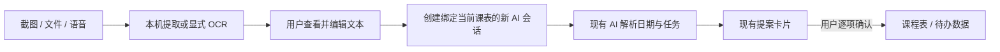

# 截图、文件和语音导入小组件方案

更新日期：2026-09-28

## 目标和安全边界

把公告、考试安排和课程材料导入后，提取可见文本与时间，由现有 AI 对话整理为待办/考试提案。任何导入内容都只是用户数据，不能被当作系统指令；小组件只负责采集、预览和转交，不直接写入课程表。最终仍由用户在 AI 页逐项确认操作卡。

## 导入方式

| 输入 | 处理方式 | 边界 |
|---|---|---|
| 截图或照片 | 用户选取 PNG/JPEG/WebP/GIF，先在本机预览；用户按“识别截图文字”后由后端将单张图片临时转发给 DeepSeek Vision，返回 OCR 文本供用户编辑。 | 默认模型为 `deepseek-flash`；限制 4 MiB 图片，不保存图片、不写入日志，不接受远程 URL。其他模型若不支持图像输入，会返回可见错误。 |
| 拖入文件 | 浏览器本地读取 TXT、CSV、HTML、ICS；PDF 用 PDF.js 提取文本；DOCX 用 Mammoth 提取正文。 | 限制文件大小、PDF 页数和正文长度；不执行导入 HTML/宏。扫描版 PDF 没有文本层时提示用户改拖截图。 |
| 语音输入 | 用户点击麦克风后使用浏览器 `SpeechRecognition`，把识别文本放回可编辑文本框。 | API 支持依浏览器而异；部分浏览器默认使用在线识别服务，录音可能离开设备。首次点击前说明这一点，提供拒绝/手动输入路径。 |

DeepSeek 官方文档列出 `deepseek-flash` 的图像输入以及 base64 data URL 方式：[Vision API](https://api-docs.deepseek.com/guides/vision/)。浏览器语音识别的兼容性有限，且默认实现可能通过服务端识别：[MDN SpeechRecognition](https://developer.mozilla.org/en-US/docs/Web/API/SpeechRecognition)、[MDN Web Speech API](https://developer.mozilla.org/en-US/docs/Web/API/Web_Speech_API)。桌面 WebView2 只在本地可信 origin 且用户手势触发时允许麦克风：[权限类型](https://learn.microsoft.com/en-us/microsoft-edge/webview2/reference/winrt/microsoft_web_webview2_core/corewebview2permissionkind)、[IsUserInitiated](https://learn.microsoft.com/en-us/dotnet/api/microsoft.web.webview2.core.corewebview2permissionrequestedeventargs.isuserinitiated)。PDF 文本提取使用 PDF.js 文档/页面 API：[PDF.js 示例](https://mozilla.github.io/pdf.js/examples/)；DOCX 只用 Mammoth 提取原始文本、不渲染 HTML：[Mammoth 文档](https://github.com/mwilliamson/mammoth.js)。

## AI 处理流程

AI 提示要求只依据材料中的明确日期和事件，不猜年份、不静默补全缺失信息；日期不明确时先提问。用户可在发送前修正 OCR/文件文本，在 AI 页继续编辑提示。已有 AI 提案确认流程继续负责跨课表校验、冲突提示和事务写入。

## 小组件原型范围

第一版以应用内浮动按钮打开导入对话框；支持文本/CSV/HTML/ICS/PDF/DOCX、图片 OCR、中文语音转写、文本预览编辑和转交当前课表 AI 会话。识别图片需要后端 AI Key 及支持 Vision 的模型；其他文件优先本机解析。扫描 PDF、批量文件、音频文件上传、离线语音、重复事件合并和自动排课不纳入第一版。

验证重点：本机文件解析不触网；图片大小和 MIME 受前后端双重限制；图片不持久化；麦克风只能由用户手势启动，权限只授予本地应用 origin 且请求需由用户发起；导入文本必须先预览和编辑；AI 操作仍必须显式确认。若 Web Speech / WebView2 环境不支持，手动输入必须仍可完成同一流程。
