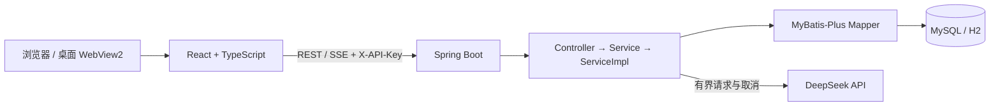

# Tangent-Timetable 项目结构与当前架构

更新日期：2026-09-28。本文描述当前工作分支中的项目结构和优化后的主要边界；过往源码审阅记录在 `docs/archive/handoff-2026-09-26/`。详细问题修复与验证结果见 [优化实施状态](OPTIMIZATION_STATUS.md)，风险和建议见 [优化方案](OPTIMIZATION_PROPOSAL.md)。

## 项目组成

| 路径 | 职责 |
|---|---|
| `src/frontend` | React、TypeScript、Ant Design 和 Vite 的 Web 应用，也是桌面版嵌入的页面。 |
| `src/backend` | Spring Boot REST/SSE 服务；MyBatis-Plus 访问 MySQL 或 H2；承载课表、待办、身份权限和 AI 业务。 |
| `src/desktop` | WinForms/WebView2 外壳、Windows 构建、包校验和隔离冒烟脚本。 |
| `scripts/desktop` | 随桌面包提供的离线数据库恢复工具。 |
| `docs` | 当前开发/运行说明、桌面说明、评审和历史交接文档。 |

Web 部署使用 MySQL/MariaDB；Windows 桌面版通过 `standalone` profile 使用本机 H2 文件库，调用同一套前后端业务。后端源代码按 Java 17 编译；桌面打包使用 `src/desktop/toolchain.json` 锁定的 JDK 21、Node/npm、WebView2 SDK 和 C# 编译器。

## 数据归属与主要关系

`api_key` 是用户账号标识。普通待办和循环规则按账号隔离；课程、考试属于一个 `schedule`；课表本身、课程和考试操作必须同时校验账号与课表。AI 对话可绑定工作课表，课程/考试提案在该工作区执行；用户级待办提案仍按账号级范围处理。

课表删除在一个事务中处理其课程、考试关联的待办、对话绑定及待执行提案。考试开始/结束时间也会同步关联的考试待办。数据库不依赖 `CREATE TABLE IF NOT EXISTS` 推断旧库结构：Flyway 分 H2/MySQL 迁移目录，先识别兼容的旧表结构，再 baseline 和迁移；未知或部分损坏结构会停止启动，避免静默覆盖。

## AI 请求与写操作

1. 前端通过 SSE 发送问题和当前会话，停止请求时用 `AbortController` 取消。
2. 后端仅收集有上限的课表、近期相关数据及聊天历史，再发起受总时限、空闲时限和响应体上限约束的上游请求。
3. 模型回复需完整结束并通过 allowlist/数据校验。未知、残缺或被截断的操作不会产生待执行提案。
4. 提案绑定账号、会话、课表和数据指纹。确认时以状态条件更新原子领取，再调用课程、考试或待办业务服务；重复确认、越界 ID 和已经过期的提案会被拒绝。
5. 用户可以逐项执行提案；成功后前端刷新相关数据。聊天消息和会话列表提供游标分页。

AI 配置有部署级共享 Key 和桌面本机 Key 两个边界。服务端角色在数据库中持久化，服务端对全局节次与共享设置接口进行授权，不以用户显示名称作为权限依据；桌面本机 Key 只能在 standalone 配置打开时使用。

## 循环待办和时间

循环调度采用 `Asia/Shanghai` 注入时钟。固定频率规则和自定义脚本规则使用持久化游标、条件领取、唯一任务约束和有界补扫；后台任务运行在线程数受限的调度池。待办由未完成转为完成时才接出下一期，同一条记录不会因重复完成而重复生成下一期。

Rhino 自定义规则受指令数和运行时间限制，但与应用运行在同一个 JVM；这不能等同于跨进程安全沙箱。允许不可信用户编辑脚本前，应评估隔离进程或关闭自定义脚本功能。

## 桌面运行、凭据与恢复

桌面外壳只导航到准确的 `http://127.0.0.1:17817/` origin。监听端口需要归属于本应用启动的后端进程；外部 HTTP(S) 链接交给系统浏览器；弹窗、iframe 和未授权 origin 被阻止。DPAPI `CurrentUser` 保护桌面 Key，且 Key 不通过 Java 进程参数传递。

H2 自动备份带校验和与迁移版本；管理员可列出、下载和预览备份。随包恢复脚本要求明确提供期望 SHA-256 并显式确认应用，保留被替换数据库的副本。备份不包含 DPAPI Key；恢复到另一个 Windows 用户时必须重新建立凭据。

## 当前工程边界

后端分页目录 API 和 AI 会话游标 API 已实现，旧全量列表接口仍为兼容性保留；当前主界面仍使用部分全量列表。H2 测试已覆盖迁移、权限、跨课表、AI 提案、备份恢复及循环规则，前端 typecheck/lint/build 通过。真实 MariaDB 升级、真实 DeepSeek 联调和固定 WebView2 Runtime 发行构建尚未完成，具体验证边界以 [优化实施状态](OPTIMIZATION_STATUS.md) 为准。

未来 Android/Windows 统一账号、离线同步、旧数据迁移及服务器上线见 [账号与云同步上线方案](ACCOUNT_SYNC_ROLLOUT_PLAN.md)。该文是规划，当前设备自动登录尚不提供跨设备账号同步。
