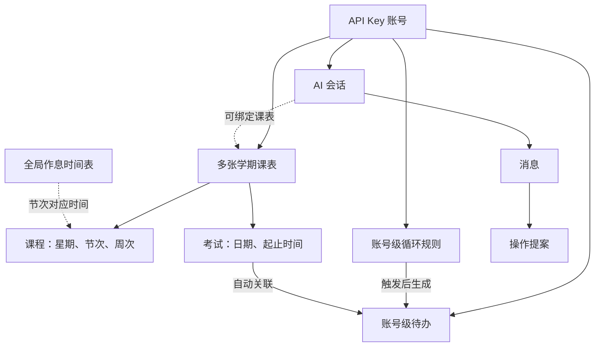
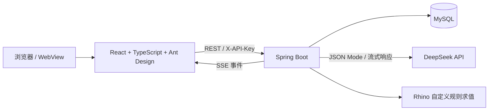

> 工作区说明：本文件记录读取 Web 修复版 `32de25c` 时的项目认识，文中 `fixed` / `original` 指来源版本；当前项目已纳入桌面版 `8f4f686`，源码位于 `src`，源码证据链接已改到新目录。桌面版新增 H2、界面设置 AI Key 及 Windows 外壳，具体见 [桌面版说明](../desktop/README.md)。建立过程见 [WORKSPACE_SETUP](../WORKSPACE_SETUP.md)。

# Tangent-Timetable 项目理解与接手说明

阅读日期：2026-09-26。对象：`E:\deepseek work\Tangent-Timetable-交付`。

本说明基于交付文档、`fixed` 当前源码、Git 差异及现存测试报告整理。本轮以阅读和静态核对为主，没有修改原项目，没有启动服务或重新运行测试；历史运行结论与本轮核对结论分开说明。

## 1. 项目定位与版本基线

“大切课程表”是面向大学生及小规模朋友共享使用的日程 Web 应用。核心是课程表、考试、待办和循环规则，AI 用来降低录入和修改成本。一个 API Key 对应一个账号的数据空间。

交付包有两份独立仓库：

| 内容 | 当前认识 |
|---|---|
| `original` | 原版代码，基线提交 `57313b1` |
| `fixed` | 当前修复版，分支 `fix/critical-high`，提交 `32de25c` |
| `fixed` 内的 `main` | 仍指向 `57313b1`，可直接用于比较 |
| 修复差异 | 本轮 `git diff --stat main..HEAD` 为 **23 个文件，+727/-190** |
| 工作区 | `fixed` 干净；`original` 显示 `backend/mvnw.cmd` 修改，交付记录将其解释为换行符问题，本轮未再做字节级复核 |
| 发布状态 | 交付记录称修复提交未推送；本轮未访问远端，不能据此判断当前远端或线上版本 |

后续讨论默认以 `fixed` 为实现基准，`original` 用于理解修复前行为。报告编号 A/B/C 来自前次审查，并非本轮重新评级。

## 2. 文档地图与阅读优先级

| 文档 | 用途 | 阅读时的注意点 |
|---|---|---|
| 交付包 `README.md` | 版本、目录、前次本机运行方式、修复摘要 | 本机环境和数据库状态属于历史记录；变更统计有旧数字 |
| `01-全对话记录.md` | 前次需求、审查、启动、修复与验证的来龙去脉 | 适合还原决策，不等同于当前环境实况 |
| `02-代码审查报告.md` | A1/A2、B1–B6、C1–C29 与低危/文档项 | **顶部是修复后状态，正文主要保留修复前状态** |
| `03-修复补丁.patch` | 搬运、复核修复内容 | 当前 `fixed` 已包含对应修复，不应再次叠加 |
| `fixed/README.md` | 产品能力、快速开始、配置入口 | 部分鉴权文字未同步修订 |
| `fixed/AGENTS.md` | 开发约定、完整模块说明、AI/循环机制与踩坑 | 内容丰富，但个别旧描述与新代码并存 |
| `docs/PRD.md` | 产品意图、数据模型、AI 交互原则 | 混有早期方案，如单个 `action` 响应和“顶部固定 AI 输入框” |
| `docs/ARCHITECTURE.md` | 当前分层和关键机制概览 | 最适合建立整体结构，再去代码验证边界 |
| `docs/USER_MANUAL.md` | 普通用户操作流程 | 用来理解实际使用场景 |
| `docs/WEBVIEW_WIDGET.md` | 小组件与全屏 WebView 两种承载方式 | 这是网页及接口能力说明，不代表仓库包含原生客户端 |
| `docs/DEPLOYMENT.md` | Nginx、systemd、数据库与升级步骤 | 是部署模板；已有数据库升级仍需手工迁移 |
| `CONTRIBUTING.md` / CI | 开发与提交检查 | 贡献指南列出的检查少于 CI，后续应按 CI 核对 |

处理文档冲突时，当前源码和配置描述“实际如何运行”，PRD 描述“原本想怎样设计”，历史审查描述“当时发现了什么”。这三类信息需要分别使用。

## 3. 用户功能与数据归属

### 3.1 最关键的数据关系

课程和考试跟随课表；待办与循环规则跟随账号。**切换课表不会切换待办列表。** 作息时间表则是整个服务共享的配置。

数据库共 10 张表：`api_key`、`schedule`、`period_config`、`course`、`exam`、`todo`、`recurring_todo`、`ai_conversation`、`ai_message`、`ai_action`。

### 3.2 主要用户路径

| 模块 | 实际作用 |
|---|---|
| 登录 | 输入 API Key，验证后保存在浏览器 localStorage；没有自助注册页 |
| 课表 | 新建学期、设起止日期、切换课表；按周网格与全部课程卡片两种视图 |
| 课程 | 一条记录是一组固定“星期 + 节次 + 周次”；同名课程每周不同上课时段可以是多条记录 |
| HTML 导入 | 粘贴教务 HTML → AI 解析 → 预览、勾选 → 批量导入；解析与入库是两步 |
| 考试 | 按具体日期和起止时间管理，不绑定某个课程实体；在网格显示红色考试块 |
| 待办 | 标题、截止时间、完成状态、秒级倒计时；考试和循环来源有标识 |
| 循环规则 | 每日、每周、每月或自定义 JavaScript；生成独立的实际待办记录 |
| AI 对话 | 多轮聊天、流式回复、逐条提案确认、取消和失效提示 |
| 设置 | 作息表、主题/字号及账号、小组件相关配置 |
| 小组件 | `/widget` 只读展示页，调用聚合接口周期刷新 |

当前没有在源码中发现系统通知、Web Push、Service Worker 推送链路。PRD 的“到点提醒”应结合已实现的倒计时、定时生成和自动完成来理解，不能当作原生后台推送能力。

## 4. 技术架构与代码入口

后端采用 `Controller → Service → ServiceImpl → Mapper → 数据库`。拦截器验证 Key 并设置请求上下文，Service 通过账号及实体归属执行隔离。统一响应一般是 `{code, message, data}`，AI 流式接口使用 SSE 事件。

| 区域 | 关键入口与职责 |
|---|---|
| 后端认证 | `ApiKeyInterceptor`、`RequestContext`、`WebMvcConfig`、`AuthController` |
| 课表与课程 | `ScheduleServiceImpl`、`CourseServiceImpl` |
| 考试联动 | `ExamServiceImpl`、`ExamTodoScheduler` |
| 待办和循环 | `TodoServiceImpl`、`RecurringTodoServiceImpl`、`RecurringScheduleCalculator` |
| 自定义规则 | `RecurringScriptEvaluator` |
| AI 编排 | `AiServiceImpl`、`AiPromptBuilder`、`DeepSeekClientImpl`、`AiController` |
| JSON 流提取 | `JsonTextStreamExtractor` |
| 前端入口 | `main.tsx`、`App.tsx` |
| 前端状态 | `AppContext.tsx`、字体/主题 Context |
| 请求层 | `api/client.ts`、`api/index.ts`、`api/stream.ts` |
| 主页面 | `TimetablePage`、`TodosPage`、`AiChatPage`、`SettingsPage`、`WidgetPreviewPage` |
| AI 操作卡 | `AiActionCard` |

后端构建目标 Java 17，Spring Boot 3.2.5、MyBatis-Plus 3.5.6、Rhino 1.7.14。前端锁文件当前解析为 React 18.3.1、Ant Design 5.29.3、Vite 5.4.21、TypeScript 5.9.3。这里记录的是本地仓库版本，并未查询外部版本信息。

开发约定包括：不用 Lombok，手写构造器/getter/setter；业务异常用 `BusinessException`；复用现有业务 Service 做权限与业务校验；真实密钥不写入仓库。

## 5. 四条核心业务链

### 5.1 课程与学期

课表存学期起止日期；课程存星期、起止节次、周次数组。前端结合学期起点、当前周次和全局作息表计算展示位置。课程记录不是日历里某一次独立事件，它可以覆盖多个周次。

考试的日期和时间独立保存，显示时近似映射到节次网格占位。考试不关联课程，这是项目已经确定的产品边界。

### 5.2 考试与待办

新增考试时同步生成一条 `todo.exam_id` 关联待办，截止时间取考试开始时间；修改考试同步标题与截止时间，删除考试同步删除关联待办。后台每轮结束后间隔约 60 秒再次扫描，考试结束后自动完成关联待办。

考试对应 COURSE 提案域，但它又改变待办数据，因此后续修改考试功能时需要同时检查待办刷新、提案指纹和失效处理。删除整张课表的路径也需单独考虑，不能把单个考试删除的联动自动套到数据库级联上。

### 5.3 循环规则生成待办

固定规则保存触发时刻和截止偏移：`截止时间 = 本期触发时间 + ddlOffsetMinutes`。每日/每周/每月由计算器推算下一期；每月指定日不存在时落到月末。调度器启动补扫并按约 60 秒间隔运行，每个固定规则单次最多补 5 期。

修复版先用数据库条件更新占有本期，再生成待办，并用 `(recurring_id, ddl)` 唯一键兜底去重。定时路径只更新必要的状态字段，以免覆盖用户同时编辑的标题等内容。

自定义规则要求定义 `shouldTrigger(ctx)` 且返回布尔值。`ctx` 是日期、星期、时分、月末与上次触发间隔等纯数据；规则按分钟判断，不预先算完整的未来触发日历。保存前试运行，普通脚本错误会导致运行中的规则停用；求值资源暂不可用与脚本错误有区分。

Rhino 防护包括 Java 桥接限制、正则和动态代码限制、指令观察、栈深和堆增长检查、脚本长度及并发限制。它仍在业务 JVM 内运行，不能保证对所有原生调用实施强制终止。修复目标是降低已证实风险并限制失控数量，独立进程隔离尚未实现。

### 5.4 AI 从输入到数据库

1. 验证账号、会话归属及请求中的课表关系。
2. 加载课程、考试、待办、循环规则、作息和历史消息。
3. 注入日期/周次等上下文，并在调用模型前从已加载数据计算指纹。
4. DeepSeek 以 JSON Mode 返回 `text` 和 `actions[]`；流式过程中提取正文并发送 SSE。
5. 解析、拆分为单条操作，补充修改前快照；在短事务中保存回复与提案。
6. 用户逐条点击“确认执行”；后端再核对提案状态与数据指纹，复用业务 Service 执行。
7. 标记已执行，处理其它提案失效；同条消息内的兄弟提案刷新指纹以便继续逐个确认。

**生成提案不等于修改业务数据。** 自然语言说“确认”不承担执行按钮的职责。HTML 解析也是先预览再由用户确认导入。

提案状态为 `PENDING / EXECUTED / REJECTED / STALE`。COURSE 域包括课程和考试；TODO 域包括待办和循环规则。指纹用于发现提案生成后数据已经改变，避免照旧方案覆盖新状态。

SSE 的主要事件为 `thinking → text → planning → done`，异常使用 `error`；并非每次调用都一定逐个产生所有中间事件。浏览器接收的是后端封装的事件，后端另外消费模型服务的流。

会话可先不绑定课表，因此不能把文档中的“每个对话必然绑定课表”当作数据库强约束。账号所有权校验与同一账号内部的课表工作空间校验也不是同一层保障。

## 6. 前端状态与多端同步

前端使用 React Context 管理登录、激活课表、课程、考试、待办和循环规则。请求层统一加 `X-API-Key`，401 会触发登录状态失效处理。

普通页面每 30 秒轮询课程、考试、待办和循环规则。它不是 WebSocket 推送，也不是所有状态的增量同步；课表列表、作息和 AI 会话等有各自加载时机。小组件约每 60 秒读取一次聚合数据。

AI 执行成功后的即时刷新目前只调用课程和待办刷新，考试与循环规则列表仍依赖后续轮询等加载路径。小组件的 `todayCourses` 实际包括今天剩余和该课表未来课程，不能根据字段名把它理解成“仅今天”；未结束考试最多取 3 条，待办汇总筛选未完成项。

AI 页按会话保存流状态，工作空间与当前课表不一致时锁定输入及操作按钮。卡片逐条执行，不提供“全部执行”。字体/主题/API Key 等浏览器状态与服务端业务数据需要区分：更换浏览器不会自动继承全部显示偏好。

修复版小组件 API 使用 `GET /api/widget/overview` 加请求头鉴权。设置页生成的页面地址把 Key 放在 fragment 中，页面取出后用于请求头；仍兼容旧查询参数。**只读页面使用的仍是账号 Key，并未另设只读凭据权限体系。**

## 7. 运行、部署与数据升级

本地开发链路是前端 Vite 5173 → `/api` 代理 → 后端 8080 → 数据库。生产文档提供 Nginx 静态文件与 API 反代、systemd 托管 jar、MySQL 存储的方案。

默认 `application.yml` 设置数据库名 `timetable`，启用自动建库选项，并以 `sql.init.mode=always` 执行建表与种子数据脚本。修复版种子数据不再插入固定演示账号；账号表为空时首启逻辑使用配置 Key 或随机生成 Key 创建首个账号。

| 配置 | 作用 |
|---|---|
| `TANGENT_COMMON_PASSWORD` | 数据库密码 |
| `DEEPSEEK_API_KEY` | 启用 AI 的服务端密钥；不配置仍可使用普通业务 |
| `DEEPSEEK_BASE_URL` / `DEEPSEEK_MODEL` | 模型服务地址和模型名称 |
| `TANGENT_BOOTSTRAP_KEY` | 空账号表首启时的初始账号 Key |
| `ADMIN_LABELS` | 可编辑全局作息表的账号 label 列表 |
| `CORS_ALLOWED_ORIGINS` | 跨域来源配置 |
| `VITE_API_BASE` / `VITE_ADMIN_LABELS` | 前端 API 地址及管理员 UI 判断 |

前次记录使用 JDK 21、Node 22 和 XAMPP MariaDB 10.4.32，并成功运行。**本轮未重新确认这些软件、服务、端口及数据库现在的状态。**

已有数据库不会因为修改 `CREATE TABLE IF NOT EXISTS` 自动增加列或索引。修复版要求的循环唯一索引、考试关联列等必须核对实际库结构。仓库没有提供完整的版本化数据库迁移体系；文件版本和实际数据库版本可能不同。

## 8. 修复状态如何理解

| 编号 | 修复内容 | 本轮静态核对与保留边界 |
|---|---|---|
| A1 | Rhino 失控执行风险 | 看到入口限制和并发约束；没有独立进程强制隔离 |
| A2 | 固定演示凭据 | 种子凭据和前端兜底已移除，增加首启账号；旧数据库中的旧账号不会因此自动删除 |
| B1 | AI 指纹基线时机 | 改为模型调用前按已加载数据计算；这不等于多个数据库查询具有统一事务快照 |
| B2 | 小组件 URL 路径凭据 | API 已改请求头并经过拦截器；页面仍兼容查询参数形式 |
| B3 | AI 断连后的继续工作 | 已贯通取消标志和 SSE 生命周期回调；属于协作取消，不能表述为所有阻塞立即终止、任何断连都绝不落库 |
| B4 | AI 线程池并发设置 | 核心与最大线程数一致，可配置；另有有界队列和拒绝策略 |
| B5 | 循环重复生成 | 有条件更新占位和唯一索引；已有数据库必须实际拥有该索引 |
| B6 | 调度覆盖用户修改 | 定时相关状态写入收缩到目标列；不应进一步推论所有并发场景均已验证 |

原交付报告将上述 8 项列为已修复。本轮确认对应实现存在，没有重新进行并发、断连或沙箱压力测试，也不把“补丁存在”升级为全场景运行保证。

## 9. 已确认的文档偏差与实现边界

| 项目 | 当前理解 |
|---|---|
| 小组件鉴权 | README/AGENTS 部分段落仍称豁免；`WebMvcConfig` 实际只排除 auth/verify，widget 必须鉴权；auth/verify 自己也读取 Key |
| 首启“管理员” | `ApiKeyBootstrap` 固定 label 为“管理员”，默认 `ADMIN_LABELS` 为 `Tangent0712`，两者不匹配；默认首账号可登录但不能因此自动编辑作息表 |
| 管理员权限 | 旧文字称仅前端限制；实际后端 `PeriodConfigServiceImpl` 也检查 label |
| Node 环境 | 文档写 Node 18+，但锁定 ESLint 10.11.0 的 engines 为 `^20.19.0 || ^22.13.0 || >=24`，Node 18 不能满足完整检查链 |
| AI 响应结构 | PRD 部分示例还是单个 `action`，实现已采用 `actions[]` 和多卡片 |
| 数据同步 | 文档的“增量/实时”不够精确；实现主要是固定间隔全量刷新若干集合 |
| 自定义单双周 | 脚本的 `weekOfYear` 是 ISO 日历周，不是从学期起点计算的教学周，两者不能直接互换 |
| 课表工作空间 | 会话/页面有保护，但并非所有实体更新都强制比较会话课表 ID；同账号跨课表属于需要单独验证的边界 |
| 变更数量 | 交付摘要写 22 文件、+650/-190；实际提交是 23 文件、+727/-190 |
| 测试通过 | 不能从 21 个测试推导出 AI、权限、数据库联动或浏览器流程全面覆盖 |

前次仍列出的 C1–C29 中等项没有整体修复完成。后续若进入维护，优先关注 AI 提案执行的并发幂等与工作空间边界、非法提案校验、考试/课表删除联动、循环状态转换，以及浏览器过期请求与刷新一致性。这里是接手顺序建议，不表示本轮已做修复。

## 10. 验证证据与下一步工作的依据

本轮直接检查了 `fixed/backend/target/surefire-reports` 中保留的 XML：

| 套件 | 测试数 | 失败 / 错误 |
|---|---:|---:|
| `RecurringScheduleCalculatorTest` | 6 | 0 / 0 |
| `RecurringScriptEvaluatorTest` | 15 | 0 / 0 |

文件时间为 2026-09-26 02:42 左右。这是历史构建制品；源码也只有上述两类后端测试。前端 package scripts 没有测试脚本，CI 运行类型检查、lint 与构建。前次交付另外记录了真实 MariaDB 回归、接口请求和沙箱线程观察，未将这些全部纳入仓库自动测试。

CI 后端使用 Java 17 运行 Maven package；前端使用 Node 20，执行 npm ci、typecheck、lint 和 build。以后修改前应先确认实际运行配置与数据库结构，再选择对应业务回归，不应只重复构建就宣布功能问题解决。

项目接手的重点是维持这些既定关系：课程/考试属于课表；待办/循环属于账号；考试联动待办；AI 只先提出方案再逐条执行；数据库变更需要迁移。新增功能或修复时，都需要沿相关链路检查影响。

## 11. 主要源码证据入口

以下链接指向本轮阅读的本机文件；行号对应当前 `fixed` 版本。

- [数据库结构与循环唯一索引](<E:/codex work/projects/Tangent-Timetable/src/backend/src/main/resources/db/schema.sql:1>)
- [认证拦截器注册](<E:/codex work/projects/Tangent-Timetable/src/backend/src/main/java/com/timetable/config/WebMvcConfig.java:18>)
- [首启账号逻辑](<E:/codex work/projects/Tangent-Timetable/src/backend/src/main/java/com/timetable/config/ApiKeyBootstrap.java:43>)
- [后端作息表权限检查](<E:/codex work/projects/Tangent-Timetable/src/backend/src/main/java/com/timetable/service/impl/PeriodConfigServiceImpl.java:60>)
- [默认配置](<E:/codex work/projects/Tangent-Timetable/src/backend/src/main/resources/application.yml:1>)
- [AI 请求编排与指纹快照](<E:/codex work/projects/Tangent-Timetable/src/backend/src/main/java/com/timetable/service/impl/AiServiceImpl.java:418>)
- [AI 提案执行](<E:/codex work/projects/Tangent-Timetable/src/backend/src/main/java/com/timetable/service/impl/AiServiceImpl.java:805>)
- [模型流读取与取消检查](<E:/codex work/projects/Tangent-Timetable/src/backend/src/main/java/com/timetable/service/impl/DeepSeekClientImpl.java:85>)
- [前端路由入口](<E:/codex work/projects/Tangent-Timetable/src/frontend/src/App.tsx:13>)
- [前端轮询范围](<E:/codex work/projects/Tangent-Timetable/src/frontend/src/store/AppContext.tsx:206>)
- [AI 执行后的即时刷新](<E:/codex work/projects/Tangent-Timetable/src/frontend/src/pages/AiChatPage.tsx:297>)
- [小组件数据聚合](<E:/codex work/projects/Tangent-Timetable/src/backend/src/main/java/com/timetable/service/impl/WidgetServiceImpl.java:53>)
- [CI 检查](<E:/codex work/projects/Tangent-Timetable/.github/workflows/ci.yml:1>)
- [完整历史审查报告及顶部修复矩阵](<E:/codex work/projects/Tangent-Timetable/docs/archive/handoff-2026-09-26/02-代码审查报告.md:1>)
